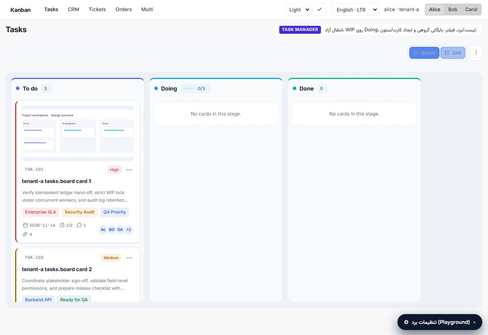

# Laravel Livewire Kanban

[](https://packagist.org/packages/karnoweb/laravel-livewire-kanban)
[](https://github.com/karnoweb/kanban-livewire/actions/workflows/tests.yml)

A configurable Kanban board and list interface for **Laravel 13** and **Livewire 4**. Connect your existing models or data providers, keep business rules in your application, and build workflows for tasks, tickets, orders, CRM opportunities, and other resources.



## Features

- **Board and list views** with drag-and-drop, keyboard interaction, independent column pagination, and compact or comfortable layouts.
- **Optional Eloquent integration** through `HasKanbanCards`, explicit source registration, scoped queries, and mixed-source boards.
- **Workflow controls** for transitions, confirmation forms, WIP capacity limits, version conflicts, and bulk actions.
- **Rich card details** with a modal or responsive drawer, lazy sections, independent permissions, and trusted custom templates.
- **Card presentation** with labels, assignees, attachment covers, checklist progress, comments, and dates supplied by your application.
- **Search, filtering, and sorting** with allowlisted fields and query-bound cursors.
- **Optional realtime updates** through the host application's Laravel broadcasting and Echo setup.
- **Localized presentation** with RTL/LTR, light/dark themes, and Jalali or Gregorian date formatting.

The package provides the interface and integration contracts. Your application owns its records, authorization, persistence, and domain services. No business model or package migration is required.

## Requirements

| Dependency | Supported version |
| --- | --- |
| PHP | 8.3 or later |
| Laravel | 13.x |
| Livewire | 4.x |
| Host CSS integration | Tailwind CSS 4 and DaisyUI 5 with the default empty prefix |

A prebuilt standalone stylesheet is also available for applications without DaisyUI. The package inherits the host font; no external font service is required.

## Installation

```bash
composer require karnoweb/laravel-livewire-kanban
php artisan vendor:publish --tag=kanban-assets
```

Laravel discovers the package service provider automatically. Publish configuration when you need application-wide overrides:

```bash
php artisan vendor:publish --tag=kanban-config
```

### Assets

**Applications using Tailwind 4 and DaisyUI 5:** add the package stylesheet to your application's global CSS. From `resources/css/app.css`:

```css
@import "../../vendor/karnoweb/laravel-livewire-kanban/resources/css/kanban.css";
```

Keep your existing Tailwind import and DaisyUI plugin configuration. The package stylesheet declares its Blade sources for class scanning. Load the published JavaScript once in your layout:

```blade
<script src="{{ asset('vendor/kanban/kanban.js') }}" defer></script>
```

**Applications without DaisyUI:** use the published standalone stylesheet and JavaScript:

```blade
<link rel="stylesheet" href="{{ asset('vendor/kanban/kanban.css') }}">
<script src="{{ asset('vendor/kanban/kanban.js') }}" defer></script>
```

The standalone stylesheet includes Tailwind, DaisyUI, and a global CSS reset. Choose one CSS integration path; do not load it alongside the source stylesheet in an existing DaisyUI application. The script does not initialize Alpine, Livewire, or Echo a second time.

See [asset installation](docs/02-installation-assets.md) and [styling and view customization](docs/11-views-customization.md).

## Quick start

### 1. Connect your data

Choose the integration that fits your application:

| Integration | Use it for |
| --- | --- |
| `HasKanbanCards` and `kanbanDefinition()` | Existing Eloquent models with mapped fields, stages, visibility, and permissions. |
| `DataProvider` and `ActionHandler` | APIs, custom persistence, or workflows managed by an existing domain service. |
| `BoardBuilder::stages()` and `cards()` | Small, explicitly supplied in-memory datasets. |

For the Eloquent path, add the trait and definition to your model before registering it. See the [model integration guide](docs/21-trait-eloquent-guide.md) for a complete example. Registering a model does not grant access to it on every board.

### 2. Define a board factory

This example assumes an explicitly registered `tasks` model source:

```php
namespace App\Kanban;

use Karnoweb\Kanban\Contracts\BoardFactory;
use Karnoweb\Kanban\Data\{BoardContext, BoardData, BoardDefinition};
use Karnoweb\Kanban\Support\BoardBuilder;

final class TaskBoardFactory implements BoardFactory
{
    public function make(BoardContext $context): BoardDefinition
    {
        return (new BoardBuilder)
            ->key('tasks.board')
            ->board(new BoardData('tasks.board', 'Tasks', $context->scopeKey))
            ->sources(['tasks'])
            ->settings([
                'pagination' => ['page_size' => 25],
                'views' => ['detail_surface' => 'drawer'],
            ])
            ->build();
    }
}
```

### 3. Register the scope, source, and board

In your application service provider:

```php
use App\Kanban\{AppScopeResolver, TaskBoardFactory};
use App\Models\Task;
use Karnoweb\Kanban\Contracts\ScopeResolver;
use Karnoweb\Kanban\Models\KanbanModelRegistry;
use Karnoweb\Kanban\Support\BoardRegistry;

public function register(): void
{
    $this->app->bind(ScopeResolver::class, AppScopeResolver::class);
}

public function boot(BoardRegistry $boards, KanbanModelRegistry $models): void
{
    $models->register('tasks', Task::class);
    $boards->register('tasks.board', TaskBoardFactory::class);
}
```

`AppScopeResolver` is a host-defined implementation of `ScopeResolver`. It must authorize the requested board and return a `BoardContext` containing the trusted board key, scope, actor, and instance identity. Derive these from server-side authentication; a browser-provided board key is not an authorization decision. See [security and scope](docs/13-multitenancy-security.md).

For domain-owned writes, supply your own `handler()` or explicitly configure the model adapter's authorization and lifecycle rules. See [action handlers](docs/06-handler-actions.md) and [CRM, Order, and Ticket examples](docs/EXAMPLES-CRM-ORDERS-TICKETS.md).

### 4. Render the component

```blade
<livewire:kanban-board board-key="tasks.board" />
```

Place it in a container with a defined height when you want columns and list content to scroll independently. See the [layout guide](docs/11-views-customization.md).

## Rich details and dates

Attach an optional `CardDetailsProvider` with `BoardBuilder::detailsProvider()` to add lazy, permission-scoped sections such as subtasks, dependencies, checklists, comments, activity, attachments, and related records. Existing providers that return only `CardData` keep the base detail view. See [Drawer integration](docs/DRAWER.md).

Iranian locale settings can use `morilog/jalali` for date presentation. Calendar, display timezone, formats, and Persian digits are configurable independently; stored values and sorting retain their original semantics. See [Jalali date settings](docs/JALALI-DATES.md).

## Documentation

| Guide | Contents |
| --- | --- |
| [Usage](docs/USAGE.md) | Installation and integration overview |
| [Configuration](docs/CONFIGURATION.md) | Defaults, features, appearance, and limits |
| [Sources](docs/SOURCES.md) | Explicit registration and per-board allowlists |
| [Eloquent integration](docs/21-trait-eloquent-guide.md) | Model definitions, mappings, and policies |
| [Multi-source boards](docs/22-multi-source-boards.md) | Source-qualified identities and stage mapping |
| [Drawer](docs/DRAWER.md) | Optional sections, pagination, permissions, and actions |
| [Customization](docs/11-views-customization.md) | Host theme tokens, layout, and Blade overrides |
| [Realtime](docs/12-realtime.md) | Broadcasting, Echo, and scoped refresh |
| [Examples](docs/EXAMPLES-CRM-ORDERS-TICKETS.md) | CRM, Order, and Ticket host adapters |
| [API reference](docs/20-api-reference.md) | Public contracts and builders |

## Development and testing

See [README_Test.md](README_Test.md) for local setup, Workbench demos, PHP and browser tests, isolated databases, benchmarks, and validation reports.

## Releases and support

- [Changelog](CHANGELOG.md)
- [Upgrade guide](UPGRADE.md)
- [GitHub releases](https://github.com/karnoweb/kanban-livewire/releases)
- [Report an issue](https://github.com/karnoweb/kanban-livewire/issues)

When reporting an issue, include package, PHP, Laravel, and Livewire versions, a minimal reproduction, and the relevant error output. Remove credentials and private application data.

## License

This package is **proprietary**. No open-source license or redistribution rights are granted by this repository.
