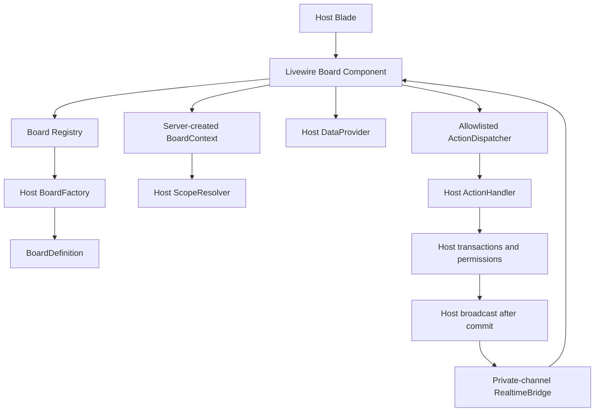

# نقشه اجرای صفر تا صد پکیج سازمانی Laravel Livewire Kanban — پنج فاز قابل تحویل داخلی

> **سند اجرایی/Runbook نسخه ۱.۰ — ۲۰۲۶/۱۰/۱۵**  
> **مرجع الزام‌ها:** `Kanban-Livewire-Enterprise-PRD-v2.0-FA.md` (همه خواسته‌ها در انتشار اول اجباری‌اند).  
> **نام و فضای نام پیشنهادی برای قفل‌کردن مسیرها:** `karnoweb/laravel-livewire-kanban`، `Karnoweb\Kanban`. در صورت انتخاب نام دیگر، **پیش از شروع فاز اول** یک‌جا در تمام فایل‌ها اصلاح شود.  
> **دامنه این فایل:** برنامه فنیِ قابل واگذاری، فهرست کامل فایل‌های خروجی، قراردادهای لازم، دستورهای کپی‌شدنی هر فاز، نمونه کد راه‌اندازی پایه، سناریوها و دروازه انتشار.  
> **مرزبندی شفاف:** فایل‌های «پایه آماده کپی» در پیوست A واقعاً دارای محتوا هستند؛ بقیه فایل‌های فهرست باید در اجرای پنج فاز **ساخته و تست شوند**. فهرست فایل یا پرامپت، به معنی وجود کد پیاده‌سازی‌شده نیست. **تا تکمیل هر پنج فاز، پکیج Production-ready نیست.**

## قرارداد تحویل و شیوه استفاده

1. مخزن خالی پکیج بساز؛ این سند و PRD v2 را در `docs/` قرار بده.
2. محتوای «پیوست A» را دقیقاً در مسیرهای ذکرشده کپی کن؛ این تنها *اسکلت شروع* است و عمداً هنوز UI عملیاتی ندارد.
3. به‌ترتیب فازهای ۱ تا ۵، متن بخش **«دستور آماده برای Cursor / عامل توسعه»** همان فاز را کپی و اجرا کن. به عامل توسعه دسترسی خواندن هر دو سند بده.
4. عامل توسعه باید همه فایل‌های ذکرشده در آن فاز را **واقعاً** بسازد، یا اگر به فایل کوچک مشترک ادغام می‌کند، با مدرک مسیر جایگزین و تأیید مالک فنی در `docs/IMPLEMENTATION-STATUS.md` ثبت کند. **هیچ قابلیت یا تستی حذف نشود.**
5. پس از هر فاز، تست‌ها را اجرا کن، گزارش را ذخیره کن، و تنها بعد از عبور از دروازه همان فاز سراغ فاز بعد برو.
6. **فازها انتشارهای ۱.۱ یا ۱.۲ نیستند.** بعد از تأیید فاز پنجم فقط نسخه `1.0.0` قابل انتشار است.

**واژه‌نامه کوتاه:** DTO (شیء انتقال داده استاندارد)، Provider (تأمین‌کننده داده)، Handler (اجراکننده عملیات میزبان)، Scope (محدوده امن داده)، Realtime (همگام‌سازی بلادرنگ)، WIP (سقف کار در جریان)، Cursor (نشانگر صفحه بعد)، Virtualization (نمایش فقط عناصر نزدیک به دید)، Idempotency (بی‌اثر بودن تکرار فرمان)، CI (اجرای خودکار تست‌ها در مخزن).

## نقشه پنج فاز

| فاز | عنوان | خروجی اصلی | شرط عبور |
|---|---|---|---|
| ۱ | پایه پکیج و قراردادهای ثابت | Composer/Facade/Registry/DTO/Provider/Handler/Scope و تست قرارداد | تعریف دو Board مستقل، بازسازی بعد درخواست، رد ورودی ناامن |
| ۲ | نمایش کامل + داده حجیم | Board/List، Theme/RTL، pagination، search/filter، virtualization و assets | نمایش درست ۱۰هزار کارت با بارگذاری صفحه‌ای واقعی |
| ۳ | عملیات کارتی/ستونی | Drag، confirmation، move/reorder، CRUD، Archive، Bulk، WIP، Details | همه عملیات با وضعیت سرور یکسان، rollback و نتیجه دقیق |
| ۴ | Realtime، امنیت و پایداری | Reverb، tenant security، dedupe/reconnect، observability | دو کاربر، دو Tenant، قطع شبکه، رویداد تکراری و تعارض موفق |
| ۵ | QA، مثال‌ها، مستندات و انتشار | ۴۴ سناریوی KB، مثال‌های ۴ دامنه، CI، کارایی و انتشار | تمام DoD نسخه ۱ و گزارش شواهد بدون استثنا |

## اصول غیرقابل مصالحه

- `src` **فاقد migration، مدل Eloquent کسب‌وکار و جدول داخلی است**؛ مدل‌های نمونه فقط زیر `workbench/` هستند.
- هویت/tenant/board مجاز از سرور بازیابی می‌شود؛ هیچ‌وقت از `scopeKey` ارسالی مرورگر مجوز استخراج نکن.
- برای نصب اصلی از Livewire 4 و Alpine همراه آن استفاده کن؛ Alpine یا Livewire جدا بارگذاری نشود.
- CSS نهایی namespaced و آماده استفاده ارائه شود؛ Tailwind 4 پروژه میزبان نباید اجباری بازپیکربندی شود.
- `build()` یک `BoardDefinition` تغییرناپذیر برمی‌گرداند؛ closure یا نمونه سرویس در state عمومی Livewire ذخیره نشود.
- هیچ عملیات موفقی قبل از تأیید سرور اعلام نشود؛ `UNKNOWN_OUTCOME` نه موفق است نه شکست قطعی.
- پیش‌فرض انتقال `deny` و همه مجوزها در لحظه اجرای Handler بررسی شوند.
- ویژگی اختیاری یعنی **قابل غیرفعال‌سازی برای یک Board**؛ نه حذف آن از نسخه اول.
- همه ۴۴ سناریوی پذیرش، مستند Markdown فارسی و تست قابل تکرار داشته باشند.

## قرارداد سازگاری انتشار ۱

| فناوری | مبنا |
|---|---|
| PHP | `^8.3` |
| Laravel | `^13.0` |
| Livewire | `^4.0` |
| Alpine | Alpine موجود همراه Livewire، بدون بارگذاری مجدد |
| Tailwind | خروجی CSS مستقل + راهنمای اتصال به Tailwind 4 میزبان |
| Broadcasting | Laravel Broadcasting؛ Reverb نمونه و تست واقعی |
| Test runner | PHPUnit/Testbench و Playwright یا Pest Browser برای مرورگر |

> انتخاب نسخه `orchestra/testbench` و `phpunit/phpunit` در اسکلت پیوست A **پیشنهادی** است؛ پیش از lockfile و CI با نسخه‌های منتشرشده همسان‌سازی و composer validate اجرا شود. هیچ ادعای اجرای Composer در این سند وجود ندارد.
## ۱. نقشه معماری بدون وابستگی به دیتابیس



### ۱.۱ الگوی مصرف‌کننده

- میزبان `CrmBoardFactory` را با شناسه ثابت `crm.deals` ثبت می‌کند؛ این کلاس در هر درخواست از DI (تزریق وابستگی) قابل ایجاد است.
- درخواست UI فقط `boardKey=crm.deals` و مقادیر نمایشی مجاز را منتقل می‌کند؛ کاربر و Tenant در `ScopeResolver` میزبان از Context امن ساخته می‌شوند.
- `BoardRegistry` نگاشت کلید به **نام کلاس** نگه می‌دارد، نه closure متصل به request.
- `BoardFactory::make(BoardContext)` یک `BoardDefinition` دارد که نام `DataProvider` و `ActionHandler` را به همراه `KanbanSettings` معرفی می‌کند.
- `Livewire Board` پیش از هر read/write مجوز و context را مجدداً به‌دست می‌آورد؛ هیچ DTO حاوی «مجوز قبلی» به‌عنوان دلیل دسترسی کافی نیست.
- نماهای عمومی `kanban::...` از provider خوانده می‌شوند و CSS آماده از `/vendor/kanban/kanban.css` بارگذاری می‌شود.

### ۱.۲ جلوگیری از اشتباه رایج در API

`Kanban::init()->onMove(fn (...) => ...)` فقط می‌تواند **در محل ثبت سروری Factory** یک adapter بسازد؛ closure نباید در ویژگی public کامپوننت Livewire نگه‌داری یا serialize شود. برای برد سازمانی به‌جای آن از `handler(MyHandler::class)` استفاده کن. حالت `cards()` ساده برای داده‌های کوچک باید به `InlineDataProvider` تبدیل شود؛ برای تعاملات چنددرخواستی، ورودی inline هر بار توسط Factory بازسازی شود. **برای داده حجیم همیشه DataProvider صفحه‌ای استفاده کن.**

### ۱.۳ API عمومی پیشنهادیِ الزام‌آور برای اجرا

| قرارداد | امضای منطقی / خروجی | قاعده |
|---|---|---|
| `Kanban::init()` | `BoardBuilder` | نمونه جدید در هر فراخوانی |
| `BoardBuilder::key(string)` | self | کلید پایدار غیرخالی |
| `BoardBuilder::board(BoardData)` / `pipeline()` | self | alias با رفتار یکسان |
| `BoardBuilder::settings(KanbanSettings)` / `setting()` | self | typed؛ آرایه فقط adapter تبدیل |
| `BoardBuilder::stages(StageData[])` | self | تبدیل به inline provider در حالت ساده |
| `BoardBuilder::cards(CardData[])` | self | برای داده کوچک و Factory قابل بازسازی |
| `BoardBuilder::provider(class-string)` | self | اجرای DI توسط میزبان |
| `BoardBuilder::handler(class-string)` | self | اجرای همه تغییرات از این قرارداد |
| `BoardBuilder::onMove/onClick` | self | alias برای registration در سرور، نه closure در Livewire state |
| `BoardBuilder::cardView/columnView/listView` | self | view whitelist |
| `BoardBuilder::build()` | BoardDefinition | اعتبارسنجی و immutable |
| `BoardRegistry::register(key, factoryClass)` | void | خطا برای تکرار key |
| `BoardRegistry::resolve(key, serverContext)` | BoardDefinition | factory در هر Livewire request قابل resolve |
| `DataProvider::stageCards(...)` | PageResult | cursor/limit و total/loaded مستقل |
| `DataProvider::listCards(...)` | PageResult | فیلتر و sort در منبع |
| `ActionHandler::execute(command, context)` | ActionResult | allowlist، auth، tx و idempotency میزبان |

**نکته تطبیق:** در پیوست A برای کوتاه نگه‌داشتن اسکلت از `BoardBuilder::settings(array)` و `DataProvider::cards(...)` استفاده شده است؛ **وظیفه قطعی فاز ۱** تبدیل اسکلت به امضاهای typed جدول بالا و تکمیل تمام فایل‌های فاز است. بخش پیوست A صرفاً نقطه شروع قابل کپی است؛ ملاک نهایی، قرارداد این جدول و PRD v2 است.

### ۱.۴ جزئیات پیکربندی قراردادها

- `BoardContext`: `boardKey`, `scopeKey`, `actorId`, `instanceId`؛ از سرور ایجاد شود، به‌صورت قابل اعتماد در state مرورگر بازنشانی نشود.
- `BoardQuery`: `view`, `stageId?`, `cursor?`, `limit` با سقف، `search`, `filters`, `sort`, `direction`, `queryHash`؛ هر پاسخ باید به query مربوط وصل شود.
- `PageResult`: `items`, `hasMore`, `nextCursor`, `totalCount`, `isExact`, `queryHash`؛ وقتی count نامعلوم است `null` بماند.
- `MoveRequest`: `operationId`, `boardId`, `cardId`, `fromStageId`, `toStageId`, `beforeCardId?`, `afterCardId?`, `placement?`, `expectedVersion?`, `formData`.
- `ActionResult`: ۱۱ وضعیت استاندارد، خطاهای فیلدی، تعداد آیتم موفق/ردشده، شناسه‌های متأثر، نسخه جدید، refreshHints.
- `RealtimeEventData`: `schemaVersion`, `eventId`, `operationId`, `eventType`, `scope` امن، `boardId`, `entityId`, `entityVersion`, `occurredAt`.
- `KanbanSettings`: پنج گروه `views`, `features`, `pagination`, `appearance`, `realtime` و محدودیت‌های `security/interaction`; پیش‌فرض محدودیت صفحه ۲۵.

### ۱.۵ اجرای مهم‌ترین عملیات (sequence)

۱. کاربر روی کارت کلیک یا Drag می‌کند؛ UI فقط حالت موقت نشان می‌دهد. ۲. UI قبل از ارسال، Rule/Confirmation معتبر را نشان می‌دهد. ۳. درخواست دارای `operationId` یکتا و نسخه مشاهده‌شده به Livewire می‌رسد. ۴. Context امن سرور ساخته و Provider/Handler resolve می‌شود. ۵. Handler میزبان مجوز، scope، نسخه و ظرفیت WIP را **در تراکنش خودش** کنترل می‌کند. ۶. نتیجه استاندارد با داده مرجع می‌آید. ۷. UI داده قطعی را نشان داده یا refresh و rollback می‌کند. ۸. میزبان بعد از commit رویداد حداقلی را روی کانال خصوصی منتشر می‌کند. ۹. Bridge رویداد جدید را اعمال یا refetch می‌کند؛ رویداد تکراری/قدیمی نادیده گرفته می‌شود.

**حالت نامعلوم:** timeout بعد از احتمال commit موجب ثبت موفقیت حدسی یا ارسال دوباره با `operationId` تازه نمی‌شود؛ درخواست وضعیت/بازخوانی معتبر نتیجه را روشن می‌کند. تضمین دقیق یک بار در کل شبکه باید توسط ذخیره idempotency در میزبان فراهم شود.

## 2. فاز 1 — زیرساخت و قراردادها

### اجرای دقیق فاز ۱

1. از پیوست A فایل‌های اسکلت را در مسیرهای دقیق ایجاد کن؛ سپس **همه DTOها و Interfaceهای جدول معماری را کامل و تایپ‌شده کن**. مشخصات نهایی، نه نمونه کوتاه پیوست A، معیار است.
2. نصب Laravel Service Provider، Facade و alias را با Testbench اثبات کن؛ هیچ `migration` یا `Model` داخل `src/` نباشد.
3. BoardDefinition کاملاً immutable باشد و پس از build دیگر تغییر نکند؛ Facade/Manager هر بار یک Builder جدید بسازند.
4. Registry کلید board را به Factory کلاس ثبت کند؛ فرآیند Resolve در درخواست Livewire دوباره اجرا شود. کلید ناشناخته و Board تعریف‌نشده fail-closed باشند.
5. `ScopeResolver` باید interface داشته باشد؛ پیاده‌سازی با هویت/tenant پروژه اصلی صورت می‌گیرد. برای مثال‌ها FakeScopeResolver با Tenant A/B بساز.
6. اعتبارسنجی input در DTOها و سازگاری تنظیمات: شناسه غیرخالی، URLs امن، شمارش دقیق/نامعلوم، capped size, configured views nonempty, max page size, metadata cap, no raw HTML.
7. ActionHandler فقط **یک entrypoint typed و allowlisted** داشته باشد؛ ماژول میزبان در پیاده‌سازی به commandهای مجاز dispatch کند. unsupported نباید exception 500 خام بسازد.
8. مستندات تصمیم‌های معماری را هم‌زمان به `docs/ARCHITECTURE-DECISIONS.md` بنویس (حتی اگر فایل در فاز ۵ قفل نهایی می‌شود).

**دروازه فاز ۱:** PHP lint موفق؛ composer validate با ابزار در محیط توسعه موفق؛ ۲ Factory و ۲ Board هم‌زمان بدون نشت؛ DTO/Builder/Registry/Scope تست‌شده؛ state سراسری mutable و Closure در Livewire-state صفر.

### فاز 1 — فهرست دقیق فایل‌ها

> تعداد خروجی‌های فایل این فاز: **48**. هر مسیر نسبت به ریشه مخزن پکیج است.

| مسیر فایل | مسئولیت و خروجی لازم |
|---|---|
| `composer.json` | نام/نسخه/وابستگی Composer، PSR-4 و discovery را مشخص کند. |
| `config/kanban.php` | پیش‌فرض‌های امن، صفحه‌بندی، realtime، assets، telemetry و محدودیت‌ها. |
| `src/KanbanServiceProvider.php` | ثبت bindings، config، views، translations، Livewire alias و publish assets. |
| `src/Facades/Kanban.php` | Facade برای KanbanManager با API پایدار. |
| `src/Support/KanbanManager.php` | نقطه ورود init و resolveBoard؛ بدون state سراسری mutable. |
| `src/Support/BoardBuilder.php` | Builder زنجیره‌ای، اعتبارسنجی و build به Definition تغییرناپذیر. |
| `src/Support/BoardRegistry.php` | نگاشت board-key به factory-class و رد کلید تکراری. |
| `src/Support/BoardDefinitionValidator.php` | اعتبارسنجی کلید، همپوشانی شناسه‌ها، تنظیمات و قرارداد Provider/Handler. |
| `src/Support/ContextFactory.php` | Context امن سروری از هویت/tenant resolver میزبان؛ بدون اعتماد به کلاینت. |
| `src/Contracts/BoardFactory.php` | ساخت مجدد BoardDefinition از key و Context در هر درخواست. |
| `src/Contracts/ScopeResolver.php` | استخراج tenant/user/board مجاز در سمت سرور؛ implementation متعلق به میزبان. |
| `src/Contracts/DataProvider.php` | قرارداد read: board/stages/cards/list/counts/card/archives/capabilities/operationStatus. |
| `src/Contracts/ActionHandler.php` | قرارداد execute(command, context) و پاسخ ActionResult. |
| `src/Contracts/PreferenceStore.php` | قرارداد ذخیره ترجیحات اختیاری؛ session/local adapter. |
| `src/Contracts/Monitor.php` | Hook کم‌اطلاعات برای زمان عملیات و خطا؛ adapter Null. |
| `src/Contracts/AuditSink.php` | Hook ثبت موفق عملیات توسط میزبان بعد از commit. |
| `src/Data/BoardContext.php` | شناسه scope امن، board key، user context، instance id. |
| `src/Data/BoardDefinition.php` | DTO تغییرناپذیر شامل key/provider/handler/settings/views. |
| `src/Data/BoardData.php` | id/title/description/scope/version/permissions. |
| `src/Data/StageData.php` | id/board/title/order/visible/readOnly/disabled/wip/counts. |
| `src/Data/CardData.php` | شناسه‌ها، metadata امن، مسئولان، پیوست، actions، مجوزها، version. |
| `src/Data/AssigneeData.php` | id/name/avatar و متن جایگزین امن. |
| `src/Data/AttachmentData.php` | id/name/mime/size/authorized URL/thumbnail. |
| `src/Data/CardBadgeData.php` | متن و رنگ معنایی whitelist‌شده. |
| `src/Data/CardActionData.php` | شناسه action مجاز، label، icon، confirmation policy. |
| `src/Data/BoardQuery.php` | search/filters/sort/dir/view/cursor/limit و query hash. |
| `src/Data/PageResult.php` | items/nextCursor/hasMore/totalCount/countExact/querySignature. |
| `src/Data/CountResult.php` | تعدادهای exact/approx/unknown به تفکیک Stage. |
| `src/Data/ActionCommand.php` | envelope مشترک فرمان‌ها با operationId و payload تایپ‌شده. |
| `src/Data/ActionResult.php` | status/messageCode/fieldErrors/affectedIds/versions/refreshHints. |
| `src/Data/MoveRequest.php` | from/to/anchor/expectedVersion/confirmation/operationId. |
| `src/Data/RealtimeEventData.php` | contractVersion/eventId/operationId/scope/board/type/version. |
| `src/Data/KanbanSettings.php` | گروه تنظیمات typed؛ reject if both views disabled. |
| `src/Enums/ActionStatus.php` | SUCCESS/VALIDATION_ERROR/FORBIDDEN/NOT_FOUND/CONFLICT/WIP_LIMIT/DOMAIN_REJECTED/RATE_LIMITED/RETRYABLE_ERROR/UNKNOWN_OUTCOME. |
| `src/Enums/ViewMode.php` | BOARD و LIST و mapping بدون حدس از breakpoint. |
| `src/Enums/ConfirmationMode.php` | NONE/GENERIC/CUSTOM/FORM. |
| `src/Enums/WipMode.php` | OFF/WARNING/STRICT. |
| `src/Exceptions/InvalidBoardDefinition.php` | خطای تنظیمات در build، با نام board و علت غیرحساس. |
| `src/Exceptions/BoardAccessDenied.php` | خطای scope و مجوز بدون data leak. |
| `src/Providers/InlineDataProvider.php` | آداپتر داده کوچک با شمارش دقیق و تغییرناپذیری. |
| `src/Actions/UnsupportedActionHandler.php` | بازگرداندن نتیجه UNSUPPORTED بدون اجرای متد آزاد. |
| `src/Support/NullMonitor.php` | adapter پیش‌فرض خنثی. |
| `src/Support/NullAuditSink.php` | adapter پیش‌فرض خنثی. |
| `tests/Unit/BuilderContractTest.php` | همه aliasها، exceptionهای ناقص، تکرار key و stateless بودن. |
| `tests/Unit/DtoValidationTest.php` | شناسه رشته‌ای، count، نسخه، URL و metadata. |
| `tests/Unit/SettingsDefaultsTest.php` | مقادیر امن و invalid combinations. |
| `tests/Feature/BoardRegistryTest.php` | resolve مجدد factory در چند request؛ دو board. |
| `tests/Feature/HostScopeContextTest.php` | scope forged از کلاینت هرگز معتبر نباشد. |

### دستور آماده برای Cursor / عامل توسعه — فاز 1

```text
در نقش Senior Laravel Package Architect کار کن. دو سند داخل docs را ابتدا کامل بخوان: `Kanban-Livewire-Enterprise-PRD-v2.0-FA.md` و `KANBAN-IMPLEMENTATION-ROADMAP-v1.0-FA.md`. فقط فاز ۱ برنامه اجرایی را پیاده کن، ولی تمام نیازهای انتشار نخست را در قراردادهای عمومی از همین ابتدا پیش‌بینی کن. تمام فایل‌های بخش «فاز ۱ — فهرست دقیق فایل‌ها» را ایجاد یا تکمیل کن. از فایل‌های پیوست A به‌عنوان اسکلت اولیه استفاده کن و سپس قراردادها را با جدول ۱.۳ نهایی هماهنگ کن. Namespace=Karnoweb\Kanban، Composer package=karnoweb/laravel-livewire-kanban، PHP^8.3، Laravel^13، Livewire^4. پکیج DB/Migration/Model اجباری نداشته باشد. BoardRegistry keyed factory، immutable BoardDefinition، typed DTOs، ScopeResolver سروری، Provider/Handler typed، ActionResult status و interfaceهای optional را بساز. Closure را در Livewire public state نگه ندار. برای همه classes حداقل تست‌های فاز را بنویس. README نصب پایه و ADR قرارداد عمومی را بروزرسانی کن. قبل از خاتمه: php -l، composer validate، PHPUnit و بررسی پوشش سناریو را اجرا کن. اگر ابزار/Dependency در محیط نیست، آن را صریح گزارش کن؛ موفقیت تست را جعل نکن. خروجی گزارش: مسیر فایل‌های ساخته‌شده، امضاهای API، تست‌ها و نتایج واقعی، تصمیم‌های باز و عدم شروع فاز بعدی تا تأیید معیارهای فاز ۱. هیچ قابلیت را به نسخه بعد انتقال نده.
```

### گزارش اجباری تحویل فاز 1

```text
Phase / Commit Hash:
File manifest: CREATED / MODIFIED / OMITTED with reason:
API contracts added or changed:
Test command / Actual output / Failing tests:
Browser test and screenshot or trace evidence:
Security/performance coverage if applicable:
Known blockers / Mitigations:
PRD requirements mapped to files and tests:
Gate decision: PASS / FAIL (if FAIL, DO NOT continue):
```


## 3. فاز 2 — نمایش و داده با مقیاس سازمانی

### اجرای دقیق فاز ۲

1. کامپوننت Livewire class-based با نام `kanban-board` فقط `boardKey` و state قابل اعتمادِ محدود دریافت کند؛ در mount/request برای همه readها Context امن resolve شود.
2. Board حالت پیش‌فرض، List حالت هم‌ارز. Switch دستی؛ عرض صفحه نمی‌تواند view را خودکار عوض کند. disabled view هیچ‌وقت در UI قابل انتخاب نباشد.
3. هر Stage سرصفحه، شمارش exact/approx/unknown، scroll داخلی، loading مستقل و load-more دارد. **Total/Loaded/Rendered** سه شمارش جدا هستند.
4. فیلتر جست‌وجو، مسئول، اولویت، Stage، تاریخ، badge و metadata در DataProvider اعمال می‌شود؛ نه فقط روی کارت‌های دانلودشده. query hash پاسخ قدیمی را حذف می‌کند.
5. `cursor` مستقل Stage و List، no duplicate/no missing و reset صحیح با تغییر Query. وقتی sort غیر manual است، reorder در UI غیرفعال شود.
6. Virtualizer باید با ارتفاع متغیر، overscan و اسکرول Stage مستقل کار کند؛ fallback امن (در حالت Drag) مستند و تست شود، نه اختلال خاموش.
7. برای نصب میزبان CSS/JS ازپیش‌ساخته‌شده و namespaced تولید کن؛ `public/vendor/kanban`، @source اختیاری؛ JS نباید Alpine/Livewire/Echo را دوبار mount کند.
8. همه بخش‌ها RTL/LTR، روشن/تاریک، سه عرض دستگاه، کیبورد/aria، reduced motion و خطای محدود به یک Stage را پشتیبانی کنند.

**دروازه فاز ۲:** KB-001 تا KB-010 و پیش‌نیازهای KB-040/042 سبز؛ ۱۰ Stage و ۱۰هزار داده منبع، ۲۵ کارت صفحه اول هر ستون و نه ۱۰هزار DTO؛ Board/List در موبایل عملیاتی؛ فایل‌های dist در میزبان بدون Node production کار کنند.

### فاز 2 — فهرست دقیق فایل‌ها

> تعداد خروجی‌های فایل این فاز: **48**. هر مسیر نسبت به ریشه مخزن پکیج است.

| مسیر فایل | مسئولیت و خروجی لازم |
|---|---|
| `src/Livewire/Board.php` | کامپوننت اصلی class-based: mount با key، state مجاز، render، switch, refresh. |
| `src/Livewire/Concerns/LoadsBoardData.php` | load مراحل و صفحه اول و retry مستقل ستون. |
| `src/Livewire/Concerns/LoadsPages.php` | pagination مستقل مرحله و List، cursor و stale-response guard. |
| `src/Livewire/Concerns/ManagesBoardQuery.php` | search debouncing، filter، sort، reset cursor و hash. |
| `src/Livewire/Concerns/ManagesSelection.php` | selection local keyed by scope/board/query. |
| `src/Support/QueryNormalizer.php` | validate search/filters/sort allowed fields, count & size limits. |
| `src/Support/CursorGuard.php` | validate opaque cursor not exposing tenant IDs. |
| `src/Support/CountPresenter.php` | برچسب exact/approx/unknown در UI. |
| `src/Support/ViewResolver.php` | view whitelist و fallback امن بدون dynamic untrusted path. |
| `src/Support/UrlSanitizer.php` | مسدودسازی javascript: و scheme نامعتبر؛ allowlist میزبان. |
| `src/Support/DomIdFactory.php` | unique DOM IDs با instance/scope/board/card. |
| `resources/views/livewire/board.blade.php` | ریشه board و list، فیلتر و اعلان و wire:key پایدار. |
| `resources/views/components/toolbar.blade.php` | switch board/list، search، filters، ایجاد، شمارش. |
| `resources/views/components/board.blade.php` | ستون‌های افقی اسکرولی و empty states. |
| `resources/views/components/stage.blade.php` | header/stats/wip/scroll/load-more/footer. |
| `resources/views/components/stage-header.blade.php` | عنوان، accent، count، menu، ابزار reorder. |
| `resources/views/components/card.blade.php` | عنوان و metadata امن، badge، avatars، due، drag handle. |
| `resources/views/components/list.blade.php` | نمای عملیاتی با pagination/sort/select/actions. |
| `resources/views/components/list-row.blade.php` | ردیف کارت با operation و تغییر مرحله از منو. |
| `resources/views/components/card-badges.blade.php` | badge colors معنایی. |
| `resources/views/components/card-assignees.blade.php` | تصاویر/نام مسئولان با alt و fallback. |
| `resources/views/components/card-attachments.blade.php` | preview/download URLهای مجاز. |
| `resources/views/components/empty-state.blade.php` | empty-board/stage/filter با CTA مجاز. |
| `resources/views/components/error-state.blade.php` | permission-denied/offline/error/conflict جداگانه. |
| `resources/views/components/loading-state.blade.php` | initial/loading-more با aria-busy. |
| `resources/views/components/load-more.blade.php` | دکمه/observer page بعدی با unique request token. |
| `resources/views/components/filter-panel.blade.php` | فیلتر عمومی/سفارشی با validate. |
| `resources/views/components/search-box.blade.php` | debounce، clear، aria-label. |
| `resources/views/components/count-badge.blade.php` | total/loaded واضح و approximate marking. |
| `resources/views/components/theme-provider.blade.php` | theme vars namespace و dir. |
| `resources/views/components/virtual-list.blade.php` | windowed rendering با fallback امن ارتفاع متغیر. |
| `resources/js/kanban.js` | boot bridge on Livewire lifecycle، بدون Alpine.start دوم. |
| `resources/js/board-interactions.js` | scroll/keyboard/refocusing/selection/search concurrency. |
| `resources/js/virtualizer.js` | virtual window، overscan، measured height، cleanup. |
| `resources/js/announcer.js` | aria-live رویدادها و status. |
| `resources/css/kanban.css` | استایل namespaced مستقل از Tailwind میزبان، منطقی RTL/LTR. |
| `resources/dist/kanban.css` | artifact ساخته‌شده و نسخه‌بندی‌شده برای نصب مستقیم. |
| `resources/dist/kanban.js` | bundle ساخته‌شده، بدون Alpine یا Livewire مضاعف. |
| `package.json` | اسکریپت build/minify و وابستگی فقط development. |
| `vite.config.js` | ساخت assets پکیج به روش مستقل. |
| `lang/fa/kanban.php` | ترجمه کامل متن‌های داخلی فارسی. |
| `lang/en/kanban.php` | ترجمه کامل متن‌های داخلی انگلیسی. |
| `tests/Feature/BoardListRenderTest.php` | دو نما، switch، فیلتر و شمارش درست. |
| `tests/Feature/IndependentPaginationTest.php` | cursor مستقل، race، page gap و duplicate. |
| `tests/Feature/FiltersAndSearchTest.php` | server-side فقط، sort whitelist، stale response. |
| `tests/Browser/BoardResponsiveTest.php` | 320/768/1440px, RTL/LTR, dark/light, horizontal scroll scoped. |
| `tests/Browser/VirtualizationTest.php` | scroll، height var، keyboard، stable renderer. |
| `tests/Performance/LargeBoardTest.php` | ۱۰هزار کارت منبع، <=۲۵۰ بارگذاری اولیه برای ۱۰ ستون، heap/DOM bounds. |

### دستور آماده برای Cursor / عامل توسعه — فاز 2

```text
دو سند PRD v2 و Roadmap را کامل بخوان. فاز ۱ را مرور کن و فقط پس از سبز بودن تست‌هایش، **تمام فاز ۲** را اجرا کن. فایل‌های بخش «فاز ۲ — فهرست دقیق فایل‌ها» را بساز. Livewire class-based Board با Board/List عملیاتی، سوئیچ دستی، RTL/LTR، Light/Dark، mobile/tablet/desktop، HTML escape، filters/search/cursor pagination مستقل هر Stage و List، exact/loaded/rendered counts، load-more، virtualizer واقعی، query hash stale protection، CSS/JS dist namespaced و تعاملات پایه Alpine که نسخه دوم Alpine را mount نمی‌کند پیاده کن. Provider روی منبع ۱۰هزار آیتم را روی هر query backend page کند؛ هرگز ۱۰هزار CardData را ابتدا برای محدودکردن رندر دریافت نکن. List باید کامل باشد نه لینک کمکی. تمامی statusهای empty/loading/error/offline را با دسترس‌پذیری پایه بنویس. تست‌های KB-001 تا KB-010 و شرط‌های KB-040/042 را بساز و در مرورگر واقعی اجرا کن؛ آمار رندر و درخواست‌های اولیه گزارش شود. از تغییر PRD/حذف ویژگی خودداری کن. گزارش پایان فاز: فایل‌ها، خروجی واقعی، تست‌های پاس/فیل، تصاویر/لاگ Browser، کارایی، مسائل باز، آماده/غیرآماده برای فاز ۳.
```

### گزارش اجباری تحویل فاز 2

```text
Phase / Commit Hash:
File manifest: CREATED / MODIFIED / OMITTED with reason:
API contracts added or changed:
Test command / Actual output / Failing tests:
Browser test and screenshot or trace evidence:
Security/performance coverage if applicable:
Known blockers / Mitigations:
PRD requirements mapped to files and tests:
Gate decision: PASS / FAIL (if FAIL, DO NOT continue):
```


## 4. فاز 3 — عملیات کامل کارت و ستون

### اجرای دقیق فاز ۳

1. نخست PoC (آزمون امکان‌سنجی) انجام بده: `wire:sort` نسخه ۴ را برای move بین ستون، confirmation، anchor، RTL/لمسی، pagination و virtualization بررسی کن. نتیجه کتبی در معماری ثبت شود. فقط **یک** مالک Drag/DOM مجاز است.
2. `ActionDispatcher` هیچ نام متد دلخواه کلاینت را اجرا نمی‌کند؛ `ActionCommand.type` فقط از enum/allowlist شناخته‌شده تبدیل می‌شود؛ scope و permission در هر مسیر بازبینی می‌شوند.
3. اجرای Move روی same-stage با reorder خاموش هیچ نوشتنی ندارد؛ anchor قبل/بعد واقعی جایگزین index نمایشی شود. Server rejection => rollback + refetch.
4. چهار نوع تأیید: none، generic، custom، فرم تایپ‌شده (مثلاً یادداشت/علت اجباری)؛ Cancel **صفر** فراخوانی Handler. خطای اعتبارسنجی، فرم را پاک نمی‌کند.
5. فرم create-card inline در آخر Stage و create از List؛ Enter/Escape، ثبت تکراری ممنوع، شکل ظاهری pending از موفق جدا.
6. همه مدیریت Stage: create/update(rename/color/readOnly)/reorder/archive؛ archive با کارت فعال به‌طور پیش‌فرض رد شود مگر میزبان سیاست صریح بدهد.
7. همه مدیریت Card: create/update/archive/restore، فهرست آرشیو، جزئیات Modal و Drawer، action سفارشی از registry مجاز، تصویر/پیوست نمایشی بدون آپلود.
8. Bulk با انتخاب در Board/List و دو سیاست `partial` یا `all-or-nothing`؛ **atomicity میزبان** باید برای حالت all-or-nothing در transaction تضمین کند.
9. WIP warning/strict و رقابت دو نفر برای ظرفیت آخر؛ اعتبارسنجی در DB/Handler میزبان انجام می‌شود نه شمارنده UI.
10. UI برای ممنوعیت، invalid form، conflict، unknown-outcome، rate-limit و retryable error پیام اختصاصی و برگشت فوکوس دارد.

**دروازه فاز ۳:** KB-011 تا KB-033 و KB-041 سبز؛ همه فرمان‌های ActionHandler مسیر کاربردی تست‌شده دارند؛ دسترسی با روش غیر Drag ممکن است؛ و هیچ تغییری قبل از تأیید و ثبت موفق انجام نمی‌شود.

### فاز 3 — فهرست دقیق فایل‌ها

> تعداد خروجی‌های فایل این فاز: **45**. هر مسیر نسبت به ریشه مخزن پکیج است.

| مسیر فایل | مسئولیت و خروجی لازم |
|---|---|
| `src/Actions/ActionDispatcher.php` | allowlisted routing from typed ActionCommand to handler; reauthorize every request. |
| `src/Actions/MoveCoordinator.php` | move/reorder confirmation, source/target, version & anchor. |
| `src/Actions/StageCoordinator.php` | create/update/reorder/archive stage; active-card archive policy. |
| `src/Actions/CardCoordinator.php` | create/update/archive/restore/custom action. |
| `src/Actions/BulkCoordinator.php` | partial/all-or-nothing، per-item results؛ host atomic guarantee. |
| `src/Actions/ResultMapper.php` | ActionResult to UI alerts, refresh hints, field errors. |
| `src/Actions/ConfirmationResolver.php` | NONE/GENERIC/CUSTOM/FORM بر اساس from-to-card rule. |
| `src/Actions/TransitionPolicy.php` | matrix و default deny و UI hints؛ server handler authoritative. |
| `src/Actions/WipPresenter.php` | UI indicator strict/warn; never decides count for server. |
| `src/Support/OperationIdFactory.php` | UUID per logical action; repeated submission retains same ID. |
| `src/Support/RefreshPlanner.php` | refresh exact affected stages/counts/cards/board. |
| `src/Livewire/Concerns/HandlesMoves.php` | request/confirm/cancel/move/reorder/rollback. |
| `src/Livewire/Concerns/HandlesCardCrud.php` | inline/full create, update, archive, restore. |
| `src/Livewire/Concerns/HandlesStageCrud.php` | create/edit/reorder/archive stage UI actions. |
| `src/Livewire/Concerns/HandlesBulkActions.php` | selection + partial/atomic result and summary. |
| `src/Livewire/Concerns/HandlesCardDetails.php` | modal/drawer, latest authorized details. |
| `src/Livewire/Concerns/HandlesCustomActions.php` | action allowlist and registered form. |
| `src/Livewire/Concerns/HandlesPreference.php` | board/list preference scoped per user. |
| `src/Data/BulkRequest.php` | IDs cap، operationId، mode، expectedVersions. |
| `src/Data/BulkItemResult.php` | per-item success/errors, no false blanket success. |
| `src/Data/ConfirmationSchema.php` | registered fields, rules, translation, default. |
| `src/Data/CardFormSchema.php` | fields allowlist, UI-only validation hints. |
| `src/Data/StageFormSchema.php` | fields allowlist + valid colors / action. |
| `resources/views/components/move-confirmation.blade.php` | generic + custom form; cancel no domain call. |
| `resources/views/components/card-create-inline.blade.php` | Enter submit, Escape cancel, preserve invalid input. |
| `resources/views/components/card-form.blade.php` | full editable form from schema. |
| `resources/views/components/stage-form.blade.php` | create/edit stage and archive warning. |
| `resources/views/components/card-details-modal.blade.php` | modal with focus trap, Esc, latest details. |
| `resources/views/components/card-details-drawer.blade.php` | drawer alternative with focus handling. |
| `resources/views/components/card-actions.blade.php` | menu with registered permitted operations. |
| `resources/views/components/stage-actions.blade.php` | stage menu and reorder alternative. |
| `resources/views/components/bulk-toolbar.blade.php` | count, mode, result breakdown, clear selection. |
| `resources/views/components/archive-browser.blade.php` | archive search/list/restore. |
| `resources/views/components/conflict-banner.blade.php` | conflict and safe refresh/retry. |
| `resources/js/sort-adapter.js` | single DnD bridge using wire:sort if PoC proven; fallback adapter only. |
| `resources/js/confirmation.js` | form state, cancel/submit and no premature commit. |
| `resources/js/focus-manager.js` | modal focus restore & keyboard non-drag interactions. |
| `tests/Feature/MoveAuthorizationTest.php` | deny vs allowed, default deny, forged stage/tenant. |
| `tests/Feature/MoveConfirmationTest.php` | cancel no handler, required note, preserve on validation. |
| `tests/Feature/ReorderAndAnchorTest.php` | same-stage, anchor across partial pages, concurrent reorder. |
| `tests/Feature/WipAndConcurrencyTest.php` | strict last slot atomic host fixture. |
| `tests/Feature/CardStageCrudTest.php` | create/edit/archive/restore/card & stage policy. |
| `tests/Feature/BulkActionsTest.php` | partial vs atomic; per-card result. |
| `tests/Browser/MoveInteractionsTest.php` | drag/move menu/sort/rollback/RTL/mobile. |
| `tests/Browser/FormsAndFocusTest.php` | Enter/Escape/form validation/ARIA/live/keyboard. |

### دستور آماده برای Cursor / عامل توسعه — فاز 3

```text
دو سند PRD v2 و Roadmap را بخوان؛ فازهای ۱ و ۲ باید تست سبز داشته باشند. تمام فایل‌های فاز ۳ را ایجاد و پیاده کن: PoC واقعی wire:sort Livewire 4 در برابر نیازهای confirmation/pagination/anchors/virtualization/RTL و ثبت تصمیم ADR؛ Drag/drop با یک engine، move/reorder card/stage و menu+keyboard alternative؛ پیش‌فرض deny، auth مجدد سرور؛ ۴ گونه تأیید و فرم با validation preserving، cancel بدون هیچ invocation Handler؛ CRUD کارت و ستون، archive/restore، modal/drawer details، card actions allowlisted، bulk partial و atomic با مسئولیت transaction میزبان، WIP strict/warning و capacity concurrency، unknown outcome/idempotency. تمامی commandها از ActionDispatcher typed و ActionResult عبور کنند. هیچ Client-supplied method invocation آزاد نداشته باش. تست‌های KB-011..KB-033 و KB-041 را با داده‌های عددی، تست مرورگر واقعی و تست DB reference اجرا کن. گزارش دقیق فایل‌ها، تست‌ها، نتیجه دیتابیس، رفتار خطا و پوشش کامل بنویس؛ فاز بعد را شروع نکن.
```

### گزارش اجباری تحویل فاز 3

```text
Phase / Commit Hash:
File manifest: CREATED / MODIFIED / OMITTED with reason:
API contracts added or changed:
Test command / Actual output / Failing tests:
Browser test and screenshot or trace evidence:
Security/performance coverage if applicable:
Known blockers / Mitigations:
PRD requirements mapped to files and tests:
Gate decision: PASS / FAIL (if FAIL, DO NOT continue):
```


## 5. فاز 4 — همگام‌سازی، امنیت و پایداری

### اجرای دقیق فاز ۴

1. Realtime فقط وقتی Board فعال کرده listener نصب کند؛ Echo **میزبان** را مصرف کند، Echo/Reverb/Alpine دوباره نصب یا راه‌اندازی نکند. پیش‌فرض کانال خصوصی و authorization سمت میزبان.
2. میزبان بعد از commit رویداد کمینه منتشر می‌کند؛ payload داده حساس، عنوان کارت، URL پیوست یا اطلاعات Tenant دیگر ندارد. رویداد با `eventId`, `operationId`, `version` و scope معتبر مشخص می‌شود.
3. event dedupe حافظه محدود دارد؛ out-of-order قدیمی رد می‌شود؛ gap باعث refresh مرجع می‌شود؛ burst eventها coalesce می‌شوند.
4. اتصال مجدد باید کانال مجاز را احیا و داده‌های مرتبط را refetch کند، نه اینکه local state را حقیقت فرض کند؛ تغییر مجوز در زمان اتصال تست شود.
5. `ScopeResolver` و `AuthorizationGuard` تمام read/action/channel را در Testbench و host sample جداگانه بررسی کنند. همان `cardId` در Tenant A/B باید بی‌خطر باشد.
6. فرمان نامشخص پس از timeout نباید با operationId جدید مجدداً ارسال شود؛ استعلام نتیجه تکراری در میزبان نمونه پیاده شود.
7. `PreferenceStore` انتخاب Board/List را با key امن user+tenant+board ذخیره کند؛ نبود persistence باعث شکست عملکرد اصلی نشود.
8. Audit/monitoring hooks اطلاعات حساس را به گزارش عمومی منتقل نکنند؛ trace فقط status, duration, operationId و داده redacted باشد.
9. URL/XSS tests، rate limiting قابل اتصال، CSP، خطاهای غیرقابل پیش‌بینی و leak رویداد چند برد تست شوند.

**دروازه فاز ۴:** KB-034 تا KB-039، KB-043، KB-044 و تست امنیتی/دوکاربره موفق؛ listener پس از unmount صفر، channelهای غیرمجاز غیرقابل دریافت، duplicate رویداد بدون double action، offline/reconnect صحیح.

### فاز 4 — فهرست دقیق فایل‌ها

> تعداد خروجی‌های فایل این فاز: **30**. هر مسیر نسبت به ریشه مخزن پکیج است.

| مسیر فایل | مسئولیت و خروجی لازم |
|---|---|
| `src/Realtime/RealtimeBridge.php` | minimal event validation and refresh/invalidate strategies. |
| `src/Realtime/EventDeduplicator.php` | eventId LRU/bounded per instance and board. |
| `src/Realtime/EventVersionGuard.php` | discard stale events; gap detection. |
| `src/Realtime/ChannelNameFactory.php` | namespaced private channel scope-board; no raw secrets. |
| `src/Realtime/ConnectionState.php` | online/offline/reconnecting/stale state. |
| `src/Realtime/RefreshCoalescer.php` | batch event refresh to avoid N requests. |
| `src/Realtime/RealtimeSettings.php` | enabled/channel/mode/cache bounds/reconnect. |
| `src/Livewire/Concerns/HandlesRealtime.php` | rejoin/reload/concurrency/cleanup after reconnect. |
| `src/Support/ScopeHasher.php` | key partitioning non-reversible identity for cache/DOM where needed. |
| `src/Support/AuthorizationGuard.php` | validate board/stage/card on every action and read. |
| `src/Support/IdempotencyGuard.php` | browser-instance inflight guard and host result lookup; NOT host transaction. |
| `src/Support/ActionRateLimiter.php` | optional host-attached rate policy; no global silent limiter. |
| `src/Support/TelemetryDispatcher.php` | latency/error hooks with redacted metadata. |
| `src/Support/PreferenceManager.php` | persist mode filtered by validated user/scope key. |
| `src/Preferences/SessionPreferenceStore.php` | default server session adapter no package DB. |
| `src/Preferences/NullPreferenceStore.php` | stateless fallback when session unavailable. |
| `src/Realtime/BroadcastEventFactory.php` | documented minimal private payload for host publication after commit. |
| `resources/js/realtime-bridge.js` | use host Echo, private auth, on/off/unmount/reconnect/dedupe. |
| `resources/js/connection-state.js` | offline indication and throttled reconcile. |
| `resources/views/components/connection-status.blade.php` | online/offline/stale notices. |
| `resources/views/components/realtime-warning.blade.php` | fallback if Echo not present and realtime enabled. |
| `tests/Feature/ScopeIsolationTest.php` | same IDs cross tenant, direct forgery, read/write filtering. |
| `tests/Feature/RealtimeContractTest.php` | allowed event schema/channel/versions/unknown scope. |
| `tests/Feature/IdempotencyAndUnknownOutcomeTest.php` | duplicate operation/timeout result unknown with host sample. |
| `tests/Integration/ReverbTwoUsersTest.php` | real private-channel 2 users + event after commit. |
| `tests/Integration/ReconnectAndDuplicatesTest.php` | duplicate/out-of-order/disconnect/reconnect permissions. |
| `tests/Browser/RealtimeMultiBoardTest.php` | two boards/events isolation, listener leak checks. |
| `tests/Security/XssAndUrlTest.php` | XSS/attachment URL scheme/form injection. |
| `tests/Security/TenantTamperingTest.php` | cross tenant all routes/requests/broadcast channels. |
| `tests/Performance/RealtimeBurstTest.php` | storm of events bounded refresh/heap/listeners. |

### دستور آماده برای Cursor / عامل توسعه — فاز 4

```text
دو سند PRD v2 و Roadmap را بخوان و سبزبودن فازهای قبل را تأیید کن. همه فایل‌های فاز ۴ را ایجاد و تکمیل کن. Laravel Broadcasting با Reverb واقعیِ نمونه، Echo موجودِ میزبان، کانال خصوصی مجاز و after-commit publication، schema رویداد با eventId/operationId/version، dedupe، stale/out-of-order guards، coalesced refresh، listener cleanup، 2-board isolation، offline/reconnect/refetch و تغییر مجوز را پیاده کن. Tenant scope را کاملاً سمت سرور resolve کن؛ ID مشترک در دو tenant آزمایش شود. XSS/URL/security hardening، idempotency host example و UNKNOWN_OUTCOME، preference scoped و audit/monitor hooks redacted را بساز. KB-034..KB-039 و KB-043..KB-044 را با مرورگر و دو user session تست کن؛ محتوای داده حساس در broadcast صفر. خروجی پایان: همه paths، تست واقعی Reverb/Browser/Scope، گزارش listener/latency، موارد باقی‌مانده و گیت فاز ۴.
```

### گزارش اجباری تحویل فاز 4

```text
Phase / Commit Hash:
File manifest: CREATED / MODIFIED / OMITTED with reason:
API contracts added or changed:
Test command / Actual output / Failing tests:
Browser test and screenshot or trace evidence:
Security/performance coverage if applicable:
Known blockers / Mitigations:
PRD requirements mapped to files and tests:
Gate decision: PASS / FAIL (if FAIL, DO NOT continue):
```


## 6. فاز 5 — تست، یکپارچه‌سازی و انتشار

### اجرای دقیق فاز ۵

1. Workbench مستقل با راه‌اندازی Laravel 13/Livewire 4/Alpine میزبان/ Tailwind 4 ایجاد کن؛ **مدل‌ها و migrationهای این محیط فقط در `workbench/` بمانند**.
2. چهار نمونه قابل اجرا و مستند: CRM (move و note/conflict)، Ticketing (readOnly و private realtime)، Task Manager (تمام CRUD، WIP، Bulk و آرشیو)، Orders/Approvals (قانون تجاری بیرون پکیج).
3. برای KB-001 تا KB-044 **هر دو فایل PHP و Markdown فارسی** بساز. تست PHP نام کلاس معتبر داشته باشد و MD شامل داده عددی اولیه، گام‌ها، انتظار DB/UI/event و اجرای واقعی باشد.
4. تست‌ها را روی SQLite نمونه و در صورت لزوم DB تراکنشی سازگار برای concurrency اجرا کن؛ به Mock صرف برای Reverb/Browser اکتفا نکن.
5. همه docs/20 صفحه راهنما را **با نمونه کد واقعیِ قابل اجرا** بنویس؛ Quick Start روی پروژه Laravel میزبان مستقل اجرا شود.
6. CI: lint/style/static-analysis/unit/feature/integration/browser/RTL/security/performance، build assets و بسته‌بندی Composer. نصب در **پروژه جدید** و **پروژه دارای Livewire** هردو تست شوند.
7. کارایی بر اساس PRD: ۱۰ ستون، ۱۰هزار کارت نمونه، p95 رندر اولیه <=۲٫۵ ثانیه؛ Provider p95 <=۸۰۰ms روی محیط مرجع ثبت‌شده؛ UI response <=۲۵۰ms بعد از پاسخ، Drag feedback <=۱۰۰ms، صفر Console Error. اگر CI زمان پایدار ندارد محیط اختصاصی benchmark اجباری است.
8. گزارش نهایی گیت‌های امنیت/کارایی/عملکرد/مستندات و ماتریس تست را امضا کن؛ هیچ scenario fail/skip/known-critical باقی نماند.
9. `CHANGELOG`, `UPGRADE`, `SECURITY`, `LICENSE` (پس از تصمیم مالک)، tag و `1.0.0` فقط وقتی کامل باشد.

**دروازه فاز ۵:** تست‌های ۴۴ سناریو و تمام مثال‌ها در محیط مستقل موفق، مستندات اجرایی، package installable، build assets موجود، امنیت و کارایی پاس، و چک‌لیست release امضاشده. هیچ فاز ناقصی مجوز انتشار ۱.۰ ندارد.

### فاز 5 — فهرست دقیق فایل‌ها

> تعداد خروجی‌های فایل این فاز: **162**. هر مسیر نسبت به ریشه مخزن پکیج است.

| مسیر فایل | مسئولیت و خروجی لازم |
|---|---|
| `.github/workflows/tests.yml` | CI matrix PHP/Laravel/Livewire + lint/unit/feature/security/browser. |
| `.github/workflows/release.yml` | tag checks, changelog, assets bundle, packaging. |
| `phpunit.xml` | Unit/Feature/Integration/Scenarios/Performance test suites. |
| `pest.php` | در صورت انتخاب Pest؛ پیکربندی با محیط Testbench. |
| `phpstan.neon` | static analysis مسیر package و config. |
| `pint.json` | PHP formatting conventions. |
| `tests/TestCase.php` | Orchestra Testbench service provider, Livewire registration, fixtures. |
| `tests/Fixtures/InMemoryBoardFactory.php` | sample factory with two scoped boards. |
| `tests/Fixtures/InMemoryProvider.php` | all provider methods and cursor/filter/counts. |
| `tests/Fixtures/InMemoryHandler.php` | transaction/idempotency emulation for tests only. |
| `tests/Fixtures/FakeScopeResolver.php` | safe tenant A/B/user scopes. |
| `tests/Fixtures/SampleDataFactory.php` | reproducible seed with 10k items. |
| `tests/Fixtures/BroadcastHarness.php` | Reverb channels and post-commit host behavior. |
| `tests/Browser/AccessibilityTest.php` | keyboard-only/aria/WCAG critical routes. |
| `tests/Browser/MultiBoardMountUnmountTest.php` | 50x listener mount/unmount no leak. |
| `tests/Browser/AllThemesAndDirectionsTest.php` | mobile/tablet/desktop dark/light RTL/LTR. |
| `tests/Performance/BenchmarksTest.php` | p95 measures and page sizes. |
| `workbench/composer.json` | isolated sample application for development and browser. |
| `workbench/routes/web.php` | example pages read-only/simple/CRM/Ticket/Task/Orders. |
| `workbench/app/Providers/KanbanBoardServiceProvider.php` | factory registry with host scope resolver. |
| `workbench/app/Kanban/CrmBoardFactory.php` | CRM board definition. |
| `workbench/app/Kanban/TicketBoardFactory.php` | ticket board definition. |
| `workbench/app/Kanban/TaskBoardFactory.php` | task board definition. |
| `workbench/app/Kanban/OrdersBoardFactory.php` | approval flow sample. |
| `workbench/app/Kanban/CrmProvider.php` | CRM provider. |
| `workbench/app/Kanban/CrmHandler.php` | CRM handler. |
| `workbench/app/Kanban/TicketProvider.php` | ticket provider. |
| `workbench/app/Kanban/TicketHandler.php` | ticket handler. |
| `workbench/app/Kanban/TaskProvider.php` | task provider. |
| `workbench/app/Kanban/TaskHandler.php` | task handler. |
| `workbench/app/Kanban/OrdersProvider.php` | orders sample provider. |
| `workbench/app/Kanban/OrdersHandler.php` | orders approval hand-off handler. |
| `workbench/app/Models/DemoCard.php` | only workbench/host demo Eloquent model; never in src. |
| `workbench/app/Models/DemoStage.php` | only workbench Eloquent model. |
| `workbench/database/migrations/create_demo_kanban_tables.php` | only workbench fixture DB; no package migration. |
| `workbench/database/seeders/KanbanDemoSeeder.php` | seed numeric scenarios and 10k cards. |
| `workbench/resources/views/crm.blade.php` | host integration + custom card. |
| `workbench/resources/views/tickets.blade.php` | host integration + private channels. |
| `workbench/resources/views/tasks.blade.php` | full board/create/bulk. |
| `workbench/resources/views/orders.blade.php` | approval no domain logic in package. |
| `docs/README.md` | navigation, architecture overview, prerequisites. |
| `docs/01-quickstart.md` | install and simple board copyable. |
| `docs/02-installation-assets.md` | Composer, CSS compiled, Vite, CSP, asset publication. |
| `docs/03-builder-registry.md` | facade/builder/factory/hydration and multi-board. |
| `docs/04-dtos-settings.md` | all DTOs, validation, settings, defaults. |
| `docs/05-data-provider.md` | cursor, pagination, provider reference, counts and N+1. |
| `docs/06-handler-actions.md` | all command contracts and host transaction/idempotency. |
| `docs/07-board-list-ui.md` | board/list, mobile, themes, rtl, virtualization. |
| `docs/08-move-confirm-wip.md` | transition matrices, drag, confirm, WIP. |
| `docs/09-crud-archive.md` | card & stage management and archive. |
| `docs/10-filters-bulk.md` | search/filter, sort, bulk partial/atomic. |
| `docs/11-views-customization.md` | blade overrides and safe slot contracts. |
| `docs/12-realtime.md` | echo/reverb, private channels, after commit, reconnect. |
| `docs/13-multitenancy-security.md` | scope, private auth, XSS, URL, access. |
| `docs/14-preferences-templates.md` | scoped preference & app templates. |
| `docs/15-events-observability.md` | typed UI events, audit and monitoring. |
| `docs/16-testing-scenarios.md` | tests/scenarios/report how-to. |
| `docs/17-performance.md` | p95 test hardware and performance. |
| `docs/18-troubleshooting.md` | CSS, Livewire hydration, drag, realtime failures. |
| `docs/19-upgrade-compatibility.md` | semver, policy, deprecation, matrix. |
| `docs/20-api-reference.md` | full public API signatures and defaults. |
| `docs/examples/crm.md` | full source integration with sales pipeline. |
| `docs/examples/ticketing.md` | full source integration with private channel. |
| `docs/examples/task-manager.md` | full source integration including all CRUD/bulk. |
| `docs/examples/orders-approvals.md` | host-managed domain approval. |
| `README.md` | short project landing and quickstart. |
| `CHANGELOG.md` | versioned changes. |
| `UPGRADE.md` | upgrade steps and deprecations. |
| `SECURITY.md` | private vulnerability report policy. |
| `CONTRIBUTING.md` | development environment and PR/review checklist. |
| `LICENSE.md` | project license selected by owner; no invented license. |
| `docs/RELEASE-CHECKLIST.md` | all 44 KB tests, security, performance, sign-off. |
| `docs/IMPLEMENTATION-STATUS.md` | phase checklist with evidence and blockers. |
| `docs/ARCHITECTURE-DECISIONS.md` | ADRs: sortable, virtualization, scope, code policy. |
| `tests/Scenarios/KB001BoardRenderTest.php` | سناریوی پذیرش KB-001؛ مالک کاربردی فاز 2، تست نهایی فاز ۵. |
| `tests/Scenarios/KB001_BoardRender.md` | مستند فارسی با داده عددی، مراحل، expected UI/server/event و گزارش. |
| `tests/Scenarios/KB002BoardListSwitchTest.php` | سناریوی پذیرش KB-002؛ مالک کاربردی فاز 2، تست نهایی فاز ۵. |
| `tests/Scenarios/KB002_BoardListSwitch.md` | مستند فارسی با داده عددی، مراحل، expected UI/server/event و گزارش. |
| `tests/Scenarios/KB003ListDisabledTest.php` | سناریوی پذیرش KB-003؛ مالک کاربردی فاز 2، تست نهایی فاز ۵. |
| `tests/Scenarios/KB003_ListDisabled.md` | مستند فارسی با داده عددی، مراحل، expected UI/server/event و گزارش. |
| `tests/Scenarios/KB004MultipleBoardsSameCardIdTest.php` | سناریوی پذیرش KB-004؛ مالک کاربردی فاز 2، تست نهایی فاز ۵. |
| `tests/Scenarios/KB004_MultipleBoardsSameCardId.md` | مستند فارسی با داده عددی، مراحل، expected UI/server/event و گزارش. |
| `tests/Scenarios/KB005StageCountAndPageSizeTest.php` | سناریوی پذیرش KB-005؛ مالک کاربردی فاز 2، تست نهایی فاز ۵. |
| `tests/Scenarios/KB005_StageCountAndPageSize.md` | مستند فارسی با داده عددی، مراحل، expected UI/server/event و گزارش. |
| `tests/Scenarios/KB006NextStagePageTest.php` | سناریوی پذیرش KB-006؛ مالک کاربردی فاز 2، تست نهایی فاز ۵. |
| `tests/Scenarios/KB006_NextStagePage.md` | مستند فارسی با داده عددی، مراحل، expected UI/server/event و گزارش. |
| `tests/Scenarios/KB007FilterAssigneePriorityTest.php` | سناریوی پذیرش KB-007؛ مالک کاربردی فاز 2، تست نهایی فاز ۵. |
| `tests/Scenarios/KB007_FilterAssigneePriority.md` | مستند فارسی با داده عددی، مراحل، expected UI/server/event و گزارش. |
| `tests/Scenarios/KB008SearchOutOfOrderResponsesTest.php` | سناریوی پذیرش KB-008؛ مالک کاربردی فاز 2، تست نهایی فاز ۵. |
| `tests/Scenarios/KB008_SearchOutOfOrderResponses.md` | مستند فارسی با داده عددی، مراحل، expected UI/server/event و گزارش. |
| `tests/Scenarios/KB009SortGuardTest.php` | سناریوی پذیرش KB-009؛ مالک کاربردی فاز 2، تست نهایی فاز ۵. |
| `tests/Scenarios/KB009_SortGuard.md` | مستند فارسی با داده عددی، مراحل، expected UI/server/event و گزارش. |
| `tests/Scenarios/KB010TenThousandCardsTest.php` | سناریوی پذیرش KB-010؛ مالک کاربردی فاز 2، تست نهایی فاز ۵. |
| `tests/Scenarios/KB010_TenThousandCards.md` | مستند فارسی با داده عددی، مراحل، expected UI/server/event و گزارش. |
| `tests/Scenarios/KB011ValidMoveTest.php` | سناریوی پذیرش KB-011؛ مالک کاربردی فاز 3، تست نهایی فاز ۵. |
| `tests/Scenarios/KB011_ValidMove.md` | مستند فارسی با داده عددی، مراحل، expected UI/server/event و گزارش. |
| `tests/Scenarios/KB012ForbiddenMoveTest.php` | سناریوی پذیرش KB-012؛ مالک کاربردی فاز 3، تست نهایی فاز ۵. |
| `tests/Scenarios/KB012_ForbiddenMove.md` | مستند فارسی با داده عددی، مراحل، expected UI/server/event و گزارش. |
| `tests/Scenarios/KB013CancelMoveTest.php` | سناریوی پذیرش KB-013؛ مالک کاربردی فاز 3، تست نهایی فاز ۵. |
| `tests/Scenarios/KB013_CancelMove.md` | مستند فارسی با داده عددی، مراحل، expected UI/server/event و گزارش. |
| `tests/Scenarios/KB014MoveFormValidationTest.php` | سناریوی پذیرش KB-014؛ مالک کاربردی فاز 3، تست نهایی فاز ۵. |
| `tests/Scenarios/KB014_MoveFormValidation.md` | مستند فارسی با داده عددی، مراحل، expected UI/server/event و گزارش. |
| `tests/Scenarios/KB015MoveWithNoteTest.php` | سناریوی پذیرش KB-015؛ مالک کاربردی فاز 3، تست نهایی فاز ۵. |
| `tests/Scenarios/KB015_MoveWithNote.md` | مستند فارسی با داده عددی، مراحل، expected UI/server/event و گزارش. |
| `tests/Scenarios/KB016ServerRejectRollbackTest.php` | سناریوی پذیرش KB-016؛ مالک کاربردی فاز 3، تست نهایی فاز ۵. |
| `tests/Scenarios/KB016_ServerRejectRollback.md` | مستند فارسی با داده عددی، مراحل، expected UI/server/event و گزارش. |
| `tests/Scenarios/KB017SameStageReorderDisabledTest.php` | سناریوی پذیرش KB-017؛ مالک کاربردی فاز 3، تست نهایی فاز ۵. |
| `tests/Scenarios/KB017_SameStageReorderDisabled.md` | مستند فارسی با داده عددی، مراحل، expected UI/server/event و گزارش. |
| `tests/Scenarios/KB018AnchorReorderTest.php` | سناریوی پذیرش KB-018؛ مالک کاربردی فاز 3، تست نهایی فاز ۵. |
| `tests/Scenarios/KB018_AnchorReorder.md` | مستند فارسی با داده عددی، مراحل، expected UI/server/event و گزارش. |
| `tests/Scenarios/KB019IdempotentOperationTest.php` | سناریوی پذیرش KB-019؛ مالک کاربردی فاز 3، تست نهایی فاز ۵. |
| `tests/Scenarios/KB019_IdempotentOperation.md` | مستند فارسی با داده عددی، مراحل، expected UI/server/event و گزارش. |
| `tests/Scenarios/KB020UnknownOutcomeTest.php` | سناریوی پذیرش KB-020؛ مالک کاربردی فاز 3، تست نهایی فاز ۵. |
| `tests/Scenarios/KB020_UnknownOutcome.md` | مستند فارسی با داده عددی، مراحل، expected UI/server/event و گزارش. |
| `tests/Scenarios/KB021VersionConflictTest.php` | سناریوی پذیرش KB-021؛ مالک کاربردی فاز 3، تست نهایی فاز ۵. |
| `tests/Scenarios/KB021_VersionConflict.md` | مستند فارسی با داده عددی، مراحل، expected UI/server/event و گزارش. |
| `tests/Scenarios/KB022WipStrictLimitTest.php` | سناریوی پذیرش KB-022؛ مالک کاربردی فاز 3، تست نهایی فاز ۵. |
| `tests/Scenarios/KB022_WipStrictLimit.md` | مستند فارسی با داده عددی، مراحل، expected UI/server/event و گزارش. |
| `tests/Scenarios/KB023WipLastSlotConcurrencyTest.php` | سناریوی پذیرش KB-023؛ مالک کاربردی فاز 3، تست نهایی فاز ۵. |
| `tests/Scenarios/KB023_WipLastSlotConcurrency.md` | مستند فارسی با داده عددی، مراحل، expected UI/server/event و گزارش. |
| `tests/Scenarios/KB024InlineCardCreateTest.php` | سناریوی پذیرش KB-024؛ مالک کاربردی فاز 3، تست نهایی فاز ۵. |
| `tests/Scenarios/KB024_InlineCardCreate.md` | مستند فارسی با داده عددی، مراحل، expected UI/server/event و گزارش. |
| `tests/Scenarios/KB025EscapeCancelsCreateTest.php` | سناریوی پذیرش KB-025؛ مالک کاربردی فاز 3، تست نهایی فاز ۵. |
| `tests/Scenarios/KB025_EscapeCancelsCreate.md` | مستند فارسی با داده عددی، مراحل، expected UI/server/event و گزارش. |
| `tests/Scenarios/KB026CreateValidationKeepsFormTest.php` | سناریوی پذیرش KB-026؛ مالک کاربردی فاز 3، تست نهایی فاز ۵. |
| `tests/Scenarios/KB026_CreateValidationKeepsForm.md` | مستند فارسی با داده عددی، مراحل، expected UI/server/event و گزارش. |
| `tests/Scenarios/KB027StageCreateRenameColorTest.php` | سناریوی پذیرش KB-027؛ مالک کاربردی فاز 3، تست نهایی فاز ۵. |
| `tests/Scenarios/KB027_StageCreateRenameColor.md` | مستند فارسی با داده عددی، مراحل، expected UI/server/event و گزارش. |
| `tests/Scenarios/KB028StageReorderTest.php` | سناریوی پذیرش KB-028؛ مالک کاربردی فاز 3، تست نهایی فاز ۵. |
| `tests/Scenarios/KB028_StageReorder.md` | مستند فارسی با داده عددی، مراحل، expected UI/server/event و گزارش. |
| `tests/Scenarios/KB029ArchiveNonEmptyStageRejectTest.php` | سناریوی پذیرش KB-029؛ مالک کاربردی فاز 3، تست نهایی فاز ۵. |
| `tests/Scenarios/KB029_ArchiveNonEmptyStageReject.md` | مستند فارسی با داده عددی، مراحل، expected UI/server/event و گزارش. |
| `tests/Scenarios/KB030ArchiveRestoreCardTest.php` | سناریوی پذیرش KB-030؛ مالک کاربردی فاز 3، تست نهایی فاز ۵. |
| `tests/Scenarios/KB030_ArchiveRestoreCard.md` | مستند فارسی با داده عددی، مراحل، expected UI/server/event و گزارش. |
| `tests/Scenarios/KB031CardDetailsCustomActionTest.php` | سناریوی پذیرش KB-031؛ مالک کاربردی فاز 3، تست نهایی فاز ۵. |
| `tests/Scenarios/KB031_CardDetailsCustomAction.md` | مستند فارسی با داده عددی، مراحل، expected UI/server/event و گزارش. |
| `tests/Scenarios/KB032BulkPartialTest.php` | سناریوی پذیرش KB-032؛ مالک کاربردی فاز 3، تست نهایی فاز ۵. |
| `tests/Scenarios/KB032_BulkPartial.md` | مستند فارسی با داده عددی، مراحل، expected UI/server/event و گزارش. |
| `tests/Scenarios/KB033BulkAtomicTest.php` | سناریوی پذیرش KB-033؛ مالک کاربردی فاز 3، تست نهایی فاز ۵. |
| `tests/Scenarios/KB033_BulkAtomic.md` | مستند فارسی با داده عددی، مراحل، expected UI/server/event و گزارش. |
| `tests/Scenarios/KB034RealtimeTwoUsersTest.php` | سناریوی پذیرش KB-034؛ مالک کاربردی فاز 4، تست نهایی فاز ۵. |
| `tests/Scenarios/KB034_RealtimeTwoUsers.md` | مستند فارسی با داده عددی، مراحل، expected UI/server/event و گزارش. |
| `tests/Scenarios/KB035DuplicateRealtimeEventTest.php` | سناریوی پذیرش KB-035؛ مالک کاربردی فاز 4، تست نهایی فاز ۵. |
| `tests/Scenarios/KB035_DuplicateRealtimeEvent.md` | مستند فارسی با داده عددی، مراحل، expected UI/server/event و گزارش. |
| `tests/Scenarios/KB036OutOfOrderEventTest.php` | سناریوی پذیرش KB-036؛ مالک کاربردی فاز 4، تست نهایی فاز ۵. |
| `tests/Scenarios/KB036_OutOfOrderEvent.md` | مستند فارسی با داده عددی، مراحل، expected UI/server/event و گزارش. |
| `tests/Scenarios/KB037OfflineReconnectTest.php` | سناریوی پذیرش KB-037؛ مالک کاربردی فاز 4، تست نهایی فاز ۵. |
| `tests/Scenarios/KB037_OfflineReconnect.md` | مستند فارسی با داده عددی، مراحل، expected UI/server/event و گزارش. |
| `tests/Scenarios/KB038CrossTenantScopeTest.php` | سناریوی پذیرش KB-038؛ مالک کاربردی فاز 4، تست نهایی فاز ۵. |
| `tests/Scenarios/KB038_CrossTenantScope.md` | مستند فارسی با داده عددی، مراحل، expected UI/server/event و گزارش. |
| `tests/Scenarios/KB039XssInTitleTest.php` | سناریوی پذیرش KB-039؛ مالک کاربردی فاز 4، تست نهایی فاز ۵. |
| `tests/Scenarios/KB039_XssInTitle.md` | مستند فارسی با داده عددی، مراحل، expected UI/server/event و گزارش. |
| `tests/Scenarios/KB040RtlLtrDarkLightResponsiveTest.php` | سناریوی پذیرش KB-040؛ مالک کاربردی فاز 2، تست نهایی فاز ۵. |
| `tests/Scenarios/KB040_RtlLtrDarkLightResponsive.md` | مستند فارسی با داده عددی، مراحل، expected UI/server/event و گزارش. |
| `tests/Scenarios/KB041KeyboardOnlyMoveReorderTest.php` | سناریوی پذیرش KB-041؛ مالک کاربردی فاز 3، تست نهایی فاز ۵. |
| `tests/Scenarios/KB041_KeyboardOnlyMoveReorder.md` | مستند فارسی با داده عددی، مراحل، expected UI/server/event و گزارش. |
| `tests/Scenarios/KB042ReducedMotionTest.php` | سناریوی پذیرش KB-042؛ مالک کاربردی فاز 2، تست نهایی فاز ۵. |
| `tests/Scenarios/KB042_ReducedMotion.md` | مستند فارسی با داده عددی، مراحل، expected UI/server/event و گزارش. |
| `tests/Scenarios/KB043MountUnmountListenerLeakTest.php` | سناریوی پذیرش KB-043؛ مالک کاربردی فاز 4، تست نهایی فاز ۵. |
| `tests/Scenarios/KB043_MountUnmountListenerLeak.md` | مستند فارسی با داده عددی، مراحل، expected UI/server/event و گزارش. |
| `tests/Scenarios/KB044MultipleBoardsRealtimeIsolationTest.php` | سناریوی پذیرش KB-044؛ مالک کاربردی فاز 4، تست نهایی فاز ۵. |
| `tests/Scenarios/KB044_MultipleBoardsRealtimeIsolation.md` | مستند فارسی با داده عددی، مراحل، expected UI/server/event و گزارش. |

### دستور آماده برای Cursor / عامل توسعه — فاز 5

```text
دو سند PRD v2 و Roadmap را بخوان؛ فازهای ۱ تا ۴ را مرور و هر کمبود را رفع کن. فاز ۵ را ۱۰۰٪ اجرا کن: تمام مسیرهای فهرست فایل فاز ۵؛ Workbench مستقل با CRM/Ticket/Task/Orders واقعی و DB نمونه مخصوص workbench؛ ۴۴ فایل سناریوی PHP + ۴۴ فایل Markdown فارسی با عدد و نتیجه؛ همه docs/20 guide با کد قابل اجرا؛ CI از package install تا unit/feature/integration/browser/security/performance؛ lint/static analysis, CSP, assets, multi-board/tenant, Reverb واقعی و validation. اثبات کن تمام قابلیت‌های بند ۲.۱ PRD v2، حتی موارد خاموش‌شدنی روی Board، *در خود پکیج* موجودند. معیارهای عملکرد p95 PRD را روی محیط مرجع ثبت و بررسی کن. هیچ تست بحرانی skip و هیچ TODO برای نسخه اول نگذار. 1.0.0 فقط اگر تمام DoD و ۴۴ تست همراه مدارک سبز باشند؛ در غیر این صورت برچسب internal beta بزن و دلیل توقف را گزارش کن. خروجی نهایی با جدول قابلیت->فایل->تست->نتیجه، گزارش امنیت/کارایی، changelog و دستور نصب پروژه میزبان آماده کن.
```

### گزارش اجباری تحویل فاز 5

```text
Phase / Commit Hash:
File manifest: CREATED / MODIFIED / OMITTED with reason:
API contracts added or changed:
Test command / Actual output / Failing tests:
Browser test and screenshot or trace evidence:
Security/performance coverage if applicable:
Known blockers / Mitigations:
PRD requirements mapped to files and tests:
Gate decision: PASS / FAIL (if FAIL, DO NOT continue):
```

## ۷. ترتیب گام‌های ضروری بین فایل‌ها

### ۷.۱ از ابتدای مخزن تا نخستین رندر

1. `composer.json` → نصب توسعه و autoload.
2. `src/KanbanServiceProvider.php` → config/view/livewire/public assets.
3. `src/Support/BoardRegistry.php` و `src/Contracts/BoardFactory.php` → ثبت کلید stable برد.
4. `src/Support/ContextFactory.php` و `src/Contracts/ScopeResolver.php` → tenant و user معتبر.
5. `src/Data/*` و `src/Contracts/DataProvider.php` → داده تایپ‌شده/صفحه‌بندی.
6. `src/Support/BoardBuilder.php` → Definition قابل بازسازی.
7. `src/Livewire/Board.php` و `resources/views/livewire/board.blade.php` → mount و render.
8. `resources/dist/*` → نصب و تست CSS/JS در workbench میزبان.
9. `tests/*` → خطای رندر/Scope/Count/UI.

### ۷.۲ از کلیک کاربر تا ثبت تغییر

1. `resources/js/sort-adapter.js` یا منوی انتقال، فرمان Move را می‌سازد.
2. `src/Actions/ConfirmationResolver.php` نوع تأیید لازم را می‌یابد.
3. `src/Livewire/Concerns/HandlesMoves.php` پس از تأیید، `ActionCommand` امن می‌سازد.
4. `src/Actions/ActionDispatcher.php` نوع مجاز را انتخاب می‌کند و `BoardContext` جدید می‌سازد.
5. `ActionHandler` میزبان permission، version، WIP، atomicity و ذخیره را انجام می‌دهد.
6. `src/Actions/ResultMapper.php` پاسخ را به UI و refresh تبدیل می‌کند.
7. بعد از Commit، میزبان Event را منتشر و `RealtimeBridge` سایر کاربران را به‌روز می‌کند.

### ۷.۳ تصمیم قطعی برای شمارش و صفحه‌بندی

- هر Stage: `items` صفحه اول و `nextCursor` خودش را داشته باشد؛ List cursor سراسری مستقل دارد.
- تغییر query فیلتر/جست‌وجو باید cursorها/selection مربوط را بازنشانی کند.
- PageResult موفق می‌تواند `totalCount=null` برگرداند؛ UI از عدد ساختگی استفاده نکند.
- در عملیات WIP و permission **فقط داده مرجع Handler** ملاک باشد.
- manual reorder هنگام sort بر اساس dueDate/priority ممنوع یا با تغییر sort صریح مجاز شود.
- داده virtualized باید فقط loaded page باشد، نه کل دیتابیس.

### ۷.۴ API میزبان و مثال استفاده پیشنهادی (پس از اجرای کامل فازها)

```php
// app/Providers/AppServiceProvider.php (مثال برنامه میزبان)
app(\Karnoweb\Kanban\Support\BoardRegistry::class)
    ->register('crm.deals', \App\Kanban\CrmBoardFactory::class);
```

```blade
{{-- resources/views/crm/index.blade.php (برنامه میزبان) --}}
<livewire:kanban-board board-key="crm.deals" />
```

> رجیستری باید در `boot()` یک provider میزبان راه‌اندازی شود و factory از scope امن سرور resolve کند. `board-key` فقط راه یافتن Factory است، نه اثبات مجوز. برای چند برد، دو کامپوننت با `board-key`های مستقل قرار بده. **این قطعه نحوه استفاده هدف‌گذاری‌شده است، نه ادعای اینکه قبل از تکمیل فاز ۲ اجرا می‌شود.**

### ۷.۵ پشتیبانی از حالت داده کوچک

برای سادگی، API `stages()` و `cards()` باید در Factory و با InlineDataProvider کار کند، ولی `cards()` با آرایه چند هزار عنصری جانشین DataProvider نباشد. اگر create/move لازم است میزبان همچنان باید Handler معتبر ارائه دهد. عدم وجود Handler تنها در board خواندنی مجاز است؛ تلاش برای عملیات به‌صورت UNSUPPORTED با پیام امن رد شود.

## ۸. ماتریس کامل سناریوها و فایل‌های تست

تمام سناریوهای نسخه ۲ PRD عیناً با شناسه KB-001 تا KB-044 باید موجود باشند. در جدول زیر فاز پیاده‌سازی رفتار و فایل‌های آزمایش نهایی آمده است.

| سناریو | عنوان انگلیسی فایل | فاز رفتار | تست PHP | سند سناریو فارسی |
|---|---|---:|---|---|
| KB-001 | BoardRender | 2 | `tests/Scenarios/KB001BoardRenderTest.php` | `tests/Scenarios/KB001_BoardRender.md` |
| KB-002 | BoardListSwitch | 2 | `tests/Scenarios/KB002BoardListSwitchTest.php` | `tests/Scenarios/KB002_BoardListSwitch.md` |
| KB-003 | ListDisabled | 2 | `tests/Scenarios/KB003ListDisabledTest.php` | `tests/Scenarios/KB003_ListDisabled.md` |
| KB-004 | MultipleBoardsSameCardId | 2 | `tests/Scenarios/KB004MultipleBoardsSameCardIdTest.php` | `tests/Scenarios/KB004_MultipleBoardsSameCardId.md` |
| KB-005 | StageCountAndPageSize | 2 | `tests/Scenarios/KB005StageCountAndPageSizeTest.php` | `tests/Scenarios/KB005_StageCountAndPageSize.md` |
| KB-006 | NextStagePage | 2 | `tests/Scenarios/KB006NextStagePageTest.php` | `tests/Scenarios/KB006_NextStagePage.md` |
| KB-007 | FilterAssigneePriority | 2 | `tests/Scenarios/KB007FilterAssigneePriorityTest.php` | `tests/Scenarios/KB007_FilterAssigneePriority.md` |
| KB-008 | SearchOutOfOrderResponses | 2 | `tests/Scenarios/KB008SearchOutOfOrderResponsesTest.php` | `tests/Scenarios/KB008_SearchOutOfOrderResponses.md` |
| KB-009 | SortGuard | 2 | `tests/Scenarios/KB009SortGuardTest.php` | `tests/Scenarios/KB009_SortGuard.md` |
| KB-010 | TenThousandCards | 2 | `tests/Scenarios/KB010TenThousandCardsTest.php` | `tests/Scenarios/KB010_TenThousandCards.md` |
| KB-011 | ValidMove | 3 | `tests/Scenarios/KB011ValidMoveTest.php` | `tests/Scenarios/KB011_ValidMove.md` |
| KB-012 | ForbiddenMove | 3 | `tests/Scenarios/KB012ForbiddenMoveTest.php` | `tests/Scenarios/KB012_ForbiddenMove.md` |
| KB-013 | CancelMove | 3 | `tests/Scenarios/KB013CancelMoveTest.php` | `tests/Scenarios/KB013_CancelMove.md` |
| KB-014 | MoveFormValidation | 3 | `tests/Scenarios/KB014MoveFormValidationTest.php` | `tests/Scenarios/KB014_MoveFormValidation.md` |
| KB-015 | MoveWithNote | 3 | `tests/Scenarios/KB015MoveWithNoteTest.php` | `tests/Scenarios/KB015_MoveWithNote.md` |
| KB-016 | ServerRejectRollback | 3 | `tests/Scenarios/KB016ServerRejectRollbackTest.php` | `tests/Scenarios/KB016_ServerRejectRollback.md` |
| KB-017 | SameStageReorderDisabled | 3 | `tests/Scenarios/KB017SameStageReorderDisabledTest.php` | `tests/Scenarios/KB017_SameStageReorderDisabled.md` |
| KB-018 | AnchorReorder | 3 | `tests/Scenarios/KB018AnchorReorderTest.php` | `tests/Scenarios/KB018_AnchorReorder.md` |
| KB-019 | IdempotentOperation | 3 | `tests/Scenarios/KB019IdempotentOperationTest.php` | `tests/Scenarios/KB019_IdempotentOperation.md` |
| KB-020 | UnknownOutcome | 3 | `tests/Scenarios/KB020UnknownOutcomeTest.php` | `tests/Scenarios/KB020_UnknownOutcome.md` |
| KB-021 | VersionConflict | 3 | `tests/Scenarios/KB021VersionConflictTest.php` | `tests/Scenarios/KB021_VersionConflict.md` |
| KB-022 | WipStrictLimit | 3 | `tests/Scenarios/KB022WipStrictLimitTest.php` | `tests/Scenarios/KB022_WipStrictLimit.md` |
| KB-023 | WipLastSlotConcurrency | 3 | `tests/Scenarios/KB023WipLastSlotConcurrencyTest.php` | `tests/Scenarios/KB023_WipLastSlotConcurrency.md` |
| KB-024 | InlineCardCreate | 3 | `tests/Scenarios/KB024InlineCardCreateTest.php` | `tests/Scenarios/KB024_InlineCardCreate.md` |
| KB-025 | EscapeCancelsCreate | 3 | `tests/Scenarios/KB025EscapeCancelsCreateTest.php` | `tests/Scenarios/KB025_EscapeCancelsCreate.md` |
| KB-026 | CreateValidationKeepsForm | 3 | `tests/Scenarios/KB026CreateValidationKeepsFormTest.php` | `tests/Scenarios/KB026_CreateValidationKeepsForm.md` |
| KB-027 | StageCreateRenameColor | 3 | `tests/Scenarios/KB027StageCreateRenameColorTest.php` | `tests/Scenarios/KB027_StageCreateRenameColor.md` |
| KB-028 | StageReorder | 3 | `tests/Scenarios/KB028StageReorderTest.php` | `tests/Scenarios/KB028_StageReorder.md` |
| KB-029 | ArchiveNonEmptyStageReject | 3 | `tests/Scenarios/KB029ArchiveNonEmptyStageRejectTest.php` | `tests/Scenarios/KB029_ArchiveNonEmptyStageReject.md` |
| KB-030 | ArchiveRestoreCard | 3 | `tests/Scenarios/KB030ArchiveRestoreCardTest.php` | `tests/Scenarios/KB030_ArchiveRestoreCard.md` |
| KB-031 | CardDetailsCustomAction | 3 | `tests/Scenarios/KB031CardDetailsCustomActionTest.php` | `tests/Scenarios/KB031_CardDetailsCustomAction.md` |
| KB-032 | BulkPartial | 3 | `tests/Scenarios/KB032BulkPartialTest.php` | `tests/Scenarios/KB032_BulkPartial.md` |
| KB-033 | BulkAtomic | 3 | `tests/Scenarios/KB033BulkAtomicTest.php` | `tests/Scenarios/KB033_BulkAtomic.md` |
| KB-034 | RealtimeTwoUsers | 4 | `tests/Scenarios/KB034RealtimeTwoUsersTest.php` | `tests/Scenarios/KB034_RealtimeTwoUsers.md` |
| KB-035 | DuplicateRealtimeEvent | 4 | `tests/Scenarios/KB035DuplicateRealtimeEventTest.php` | `tests/Scenarios/KB035_DuplicateRealtimeEvent.md` |
| KB-036 | OutOfOrderEvent | 4 | `tests/Scenarios/KB036OutOfOrderEventTest.php` | `tests/Scenarios/KB036_OutOfOrderEvent.md` |
| KB-037 | OfflineReconnect | 4 | `tests/Scenarios/KB037OfflineReconnectTest.php` | `tests/Scenarios/KB037_OfflineReconnect.md` |
| KB-038 | CrossTenantScope | 4 | `tests/Scenarios/KB038CrossTenantScopeTest.php` | `tests/Scenarios/KB038_CrossTenantScope.md` |
| KB-039 | XssInTitle | 4 | `tests/Scenarios/KB039XssInTitleTest.php` | `tests/Scenarios/KB039_XssInTitle.md` |
| KB-040 | RtlLtrDarkLightResponsive | 2 | `tests/Scenarios/KB040RtlLtrDarkLightResponsiveTest.php` | `tests/Scenarios/KB040_RtlLtrDarkLightResponsive.md` |
| KB-041 | KeyboardOnlyMoveReorder | 3 | `tests/Scenarios/KB041KeyboardOnlyMoveReorderTest.php` | `tests/Scenarios/KB041_KeyboardOnlyMoveReorder.md` |
| KB-042 | ReducedMotion | 2 | `tests/Scenarios/KB042ReducedMotionTest.php` | `tests/Scenarios/KB042_ReducedMotion.md` |
| KB-043 | MountUnmountListenerLeak | 4 | `tests/Scenarios/KB043MountUnmountListenerLeakTest.php` | `tests/Scenarios/KB043_MountUnmountListenerLeak.md` |
| KB-044 | MultipleBoardsRealtimeIsolation | 4 | `tests/Scenarios/KB044MultipleBoardsRealtimeIsolationTest.php` | `tests/Scenarios/KB044_MultipleBoardsRealtimeIsolation.md` |

### ۸.۱ قالب یکسان همه فایل‌های سناریو

```markdown
# KB-0NN — نام فارسی سناریو
- دامنه: CRM / Ticketing / Task Manager / Orders
- فاز پیاده‌سازی:
- پیوند تست: `tests/Scenarios/KB0NN...Test.php`
- پیش‌نیاز: Laravel/Livewire/BoardFactory/Scope/Fixture
- کاربران و Tenant: User A / User B / Tenant A / Tenant B
- وضعیت اولیه: مثال Stage A = ۵ کارت، Stage B = ۴ کارت، id=101، version=3
- مراحل اجرا: ۱) ... ۲) ... ۳) ...
- نتیجه UI: کارت/شمارش/وضعیت فرم/فوکوس/خطا
- نتیجه Server: آیا Handler فراخوانی شد؟ تغییر نهایی و نسخه چیست؟
- نتیجه Event: کدام eventId/operationId/channel، تعداد انتشار چند است؟
- نتیجه تست واقعی: PASS/FAIL، دستور اجرا، زمان/سیستم، لاگ و Commit
```

### ۸.۲ مسیرهای تست سطح بالا

| مسیر | حداقل انتظار |
|---|---|
| `tests/Unit/` | تمام DTO/Builder/Validation/Enum/Query |
| `tests/Feature/` | همه read/write/permission/confirmation/CRUD/retry |
| `tests/Browser/` | واقعی drag/touch/RTL/List/modal/keyboard/Lighthouse/axe در صورت ابزار مناسب |
| `tests/Integration/` | Reverb دو کاربر، post-commit و race آخرین ظرفیت با دیتابیس تراکنشی |
| `tests/Security/` | Cross-tenant، XSS، tampering، private channel، forbidden |
| `tests/Performance/` | ۱۰هزار Card، memory/DOM، p95 و load burst |
| `tests/Scenarios/` | دقیقاً ۴۴ تست منطبق و ۴۴ فایل Markdown هم‌نام |

## ۹. معیارهای انتشار، اندازه‌گیری و تصمیم PASS/FAIL

| معیار | الزام |
|---|---|
| ۴۴ سناریوی KB | همه پاس؛ بدون skip بحرانی |
| تمام قابلیت‌های PRD §2.1 | موجود در package؛ قابلیت‌ها خاموش‌شدنی برای برد هستند ولی پیاده‌سازی حذف‌شدنی نیست |
| نصب | package نصب‌شده در پروژه تازه Laravel 13 و میزبان دارای Livewire 4 اجرا شود |
| DB independence | صفر migration/model اجباری در `src` و نصب پکیج |
| دسترس‌پذیری | WCAG 2.2 AA مسیرهای اصلی، کیبورد، فوکوس، aria، reduced motion |
| Security | عبور از ۲ tenant، permission bypass و XSS ناموفق، private channel تأیید |
| Realtime | رویداد تکراری/قدیمی، reconnect و چند Board بی‌خطر |
| Performance | p95 اولیه <= ۲٫۵ ثانیه؛ Provider p95 <= ۸۰۰ms؛ post-response UI p95 <=۲۵۰ms؛ drag feedback <=۱۰۰ms، فقط روی محیط مرجع مستند |
| Paging | ۱۰ ستون × ۲۵ کارت اولیه، بدون دریافت ۱۰هزار رکورد |
| Code health | پوشش هسته >=۸۵٪ line و >=۸۰٪ branch در ابزار قابل اندازه‌گیری؛ سبز بودن سناریوها مهم‌تر است |
| Browser Console | صفر خطای unhandled در مسیرهای اصلی |
| docs | ۲۰ راهنما + ۴ مثال + installation/upgrade/security/releases عملی و آزمایش‌شده |
| License | انتخاب واقعی مالک پروژه؛ هیچ ادعای مجوز آزاد بدون انتخاب مالک |

### ۹.۱ خط قرمزهایی که مانع tag 1.0.0 می‌شوند

- هیچ قفلی که فقط در UI باشد ولی سرور اجازه عملیات نامعتبر دهد.
- هیچ بارگذاری کامل ۱۰هزار کارتی که فقط HTML آن محدود شده باشد.
- هیچ انتشار کانال عمومی با داده مربوط به Tenant خصوصی.
- هیچ موفقیت ساختگی به دنبال timeout یا Reverb event.
- هیچ حذف کارت هنگام failure و عدم بازخوانی وضعیت واقعی.
- هیچ تست ضروری skip یا مستندات نمایشی که با API واقعی سازگار نیست.
- هیچ نیاز به مهاجرت دیتابیس به خاطر خود پکیج.

### ۹.۲ دستورات کنترل کیفیت (پس از نصب ابزارهای توسعه)

```bash
composer validate --strict
composer install
composer dump-autoload
find src tests -name '*.php' -print0 | xargs -0 -n1 php -l
vendor/bin/phpunit --testsuite Unit
vendor/bin/phpunit --testsuite Feature
vendor/bin/phpunit --testsuite Integration
vendor/bin/phpunit --testsuite Scenarios
# بسته به تنظیمات package.json و CI در فاز ۵:
npm ci
npm run build
npm run test:browser
```

> در پیوست A، فایل‌های اسکلت برای lint کافی‌اند، اما `vendor/bin/phpunit` و `npm run test:browser` تا زمان ایجاد config/tests/assets در فازهای بعد لزوماً قابل اجرا نیستند. نتیجه اجرا باید از ابزار واقعی گزارش شود، نه ادعا.

## ۱۰. قالب پیگیری پیشرفت و تحویل به توسعه‌دهنده

در `docs/IMPLEMENTATION-STATUS.md`، برای هر فاز این فرم را نگه‌دار:

```markdown
## Phase N — STATUS: NOT_STARTED | IN_PROGRESS | PASS | FAIL
- Commit SHA:
- PRD coverage:
- Files created / changed:
- Features demonstrated:
- Test commands & real outputs:
- Browser / Reverb / security evidence:
- Performance environment and p95:
- Open defects (severity):
- Gate criteria unmet:
- Approved by / date:
```

برای جلوگیری از ادعاهای غیرقابل بررسی، یک فایل `docs/RELEASE-CHECKLIST.md` با ستون‌های `Requirement | Owner file | Test | Evidence | Result` بساز و حتی موارد Optional-for-board را نیز در آن بیاور.

## ۱۱. ریسک‌ها و راه‌حل از پیش تعیین‌شده

| ریسک | راه‌حل الزام‌آور |
|---|---|
| زنده‌ماندن Closure بین Livewire requests | factory class ثبت‌شده و بازسازی در هر درخواست |
| تغییر DOM با drag/morph | یک موتور Sort و PoC مستند، محدودکردن mutation و wire:key پایدار |
| اشتباه index هنگام partial pagination | before/after anchors، validation میزبان |
| Load تمام داده‌ها برای filter | DataProvider server-side و queryHash |
| رقابت دو کاربر برای آخرین WIP | تراکنش و قفل Host handler با تست واقعی |
| پاسخ timeout بعد از commit | operationId/idempotency host + status lookup |
| Tenant leak با cardId مشابه | ScopeResolver امن + composite lookup در میزبان |
| Realtime duplicate/out-of-order | eventId dedupe + version guard + refetch |
| asset conflict با CSS میزبان | CSS prefixed dist + scoped classes + documented optional @source |
| افزوده‌شدن قابلیت جدید در آینده | DTO typed، SemVer، قرارداد extension/override مشخص و ADR |

## ۱۲. ردیابی پوشش ۳۰ بخش PRD نسخه ۲ به پنج فاز

| بخش PRD | مالک اجرایی |
|---|---|
| ۱ و ۲: هدف/محدوده | تمام فازها؛ دروازه فاز ۵ |
| ۳: پلتفرم/نصب | ۱، ۲ و ۵ |
| ۴ تا ۶: نام‌گذاری/معماری/DTO | ۱ |
| ۷: Provider/Counts/Paging/Virtualization | ۱ و ۲ |
| ۸ و ۹: Board/List/Card/Details | ۲ و ۳ |
| ۱۰: Move/Reorder/Confirmation/WIP | ۳ |
| ۱۱ و ۱۲: Create/Archive/Filter/Bulk | ۲ و ۳ |
| ۱۳: Realtime/Conflict | ۴ |
| ۱۴: Settings/Preferences | ۱، ۳ و ۴ |
| ۱۵: Views/Templates | ۲، ۳ و ۵ |
| ۱۶: Security/Tenant | ۱، ۳ و ۴ |
| ۱۷: Mobile/RTL/Accessibility | ۲، ۳ و ۵ |
| ۱۸: Operations/Results/Events | ۱، ۳ و ۴ |
| ۱۹: Performance/Observability | ۲، ۴ و ۵ |
| ۲۰: KB-001..044 | ۵ (مالک رفتار در فازهای ۲ تا ۴) |
| ۲۱ تا ۲۴: Test/Docs/Deliverables/DoD | ۵ |
| ۲۵ تا ۳۰: Sequence/Risk/Maintenance/Traceability | تمام فازها؛ تأیید ۵ |

---

## پیوست A — فایل‌های شروع، همراه محتوای واقعی آماده کپی

**توجه:** این فایل‌ها یک اسکلت اجراییِ اولیه هستند، نه نسخه آماده استفاده یا کل منبع پکیج. فایل‌های دیگر در فهرست فازها باید واقعاً نوشته شوند. جهت جلوگیری از ایجاد چند نسخه ناسازگار، بعد از کپی همین اسکلت، در **فاز ۱** همه امضاها را با بخش ۱.۳ نهایی کن. `license` در مثال Composer به‌شکل `proprietary` موقت است و مالک پروژه باید قبل از انتشار آن را تعیین کند.

### A.1 — `composer.json`

```json
{
  "name": "karnoweb/laravel-livewire-kanban",
  "description": "Domain-agnostic enterprise Kanban and List UI for Laravel Livewire",
  "type": "library",
  "license": "proprietary",
  "require": {
    "php": "^8.3",
    "illuminate/support": "^13.0",
    "livewire/livewire": "^4.0"
  },
  "require-dev": {
    "orchestra/testbench": "^11.0",
    "phpunit/phpunit": "^12.0"
  },
  "autoload": {
    "psr-4": {"Karnoweb\\Kanban\\": "src/"}
  },
  "autoload-dev": {
    "psr-4": {"Karnoweb\\Kanban\\Tests\\": "tests/"}
  },
  "extra": {
    "laravel": {
      "providers": ["Karnoweb\\Kanban\\KanbanServiceProvider"],
      "aliases": {"Kanban": "Karnoweb\\Kanban\\Facades\\Kanban"}
    }
  },
  "scripts": {"test": "vendor/bin/phpunit"},
  "minimum-stability": "stable",
  "prefer-stable": true
}
```

### A.2 — `config/kanban.php`

```php
<?php

declare(strict_types=1);

return [
    'page_size' => 25,
    'max_page_size' => 100,
    'default_view' => 'board',
    'allowed_views' => ['board', 'list'],
    'default_transition_policy' => 'deny',
    'features' => [
        'drag_drop' => true,
        'reorder_cards' => true,
        'reorder_stages' => true,
        'create_card' => true,
        'create_stage' => true,
        'archive_card' => true,
        'archive_stage' => true,
        'search' => true,
        'filters' => true,
        'bulk' => true,
        'wip' => true,
        'details' => true,
        'virtualization' => true,
        'realtime' => false,
    ],
    'assets' => [
        'publish_tag' => 'kanban-assets',
        'prefixed_path' => 'vendor/kanban',
    ],
    'limits' => [
        'search_length' => 200,
        'bulk_ids' => 100,
        'metadata_bytes' => 8192,
    ],
];
```

### A.3 — `src/KanbanServiceProvider.php`

```php
<?php

declare(strict_types=1);

namespace Karnoweb\Kanban;

use Illuminate\Support\ServiceProvider;
use Karnoweb\Kanban\Support\BoardRegistry;
use Karnoweb\Kanban\Support\KanbanManager;
use Livewire\Livewire;

final class KanbanServiceProvider extends ServiceProvider
{
    public function register(): void
    {
        $this->mergeConfigFrom(__DIR__.'/../config/kanban.php', 'kanban');
        $this->app->singleton(BoardRegistry::class);
        $this->app->bind('kanban', KanbanManager::class);
    }

    public function boot(): void
    {
        $this->loadViewsFrom(__DIR__.'/../resources/views', 'kanban');
        $this->loadTranslationsFrom(__DIR__.'/../lang', 'kanban');

        $this->publishes([
            __DIR__.'/../config/kanban.php' => config_path('kanban.php'),
        ], 'kanban-config');

        $this->publishes([
            __DIR__.'/../resources/views' => resource_path('views/vendor/kanban'),
        ], 'kanban-views');

        $this->publishes([
            __DIR__.'/../resources/dist' => public_path('vendor/kanban'),
        ], 'kanban-assets');

        if (class_exists(\Karnoweb\Kanban\Livewire\Board::class)) {
            Livewire::component('kanban-board', \Karnoweb\Kanban\Livewire\Board::class);
        }
    }
}
```

### A.4 — `src/Facades/Kanban.php`

```php
<?php

declare(strict_types=1);

namespace Karnoweb\Kanban\Facades;

use Illuminate\Support\Facades\Facade;

/** @method static \Karnoweb\Kanban\Support\BoardBuilder init() */
final class Kanban extends Facade
{
    protected static function getFacadeAccessor(): string
    {
        return 'kanban';
    }
}
```

### A.5 — `src/Support/KanbanManager.php`

```php
<?php

declare(strict_types=1);

namespace Karnoweb\Kanban\Support;

final class KanbanManager
{
    public function init(): BoardBuilder
    {
        return new BoardBuilder();
    }
}
```

### A.6 — `src/Data/BoardData.php`

```php
<?php

declare(strict_types=1);

namespace Karnoweb\Kanban\Data;

use InvalidArgumentException;

final readonly class BoardData
{
    public function __construct(
        public string $id,
        public string $title,
        public string $scopeKey,
        public ?string $description = null,
        public ?string $version = null,
    ) {
        if (trim($id) === '' || trim($title) === '' || trim($scopeKey) === '') {
            throw new InvalidArgumentException('Board id, title and scopeKey are required.');
        }
    }
}
```

### A.7 — `src/Data/BoardDefinition.php`

```php
<?php

declare(strict_types=1);

namespace Karnoweb\Kanban\Data;

final readonly class BoardDefinition
{
    public function __construct(
        public string $key,
        public BoardData $board,
        public string $providerClass,
        public string $handlerClass,
        public array $settings = [],
        public array $views = [],
    ) {}
}
```

### A.8 — `src/Support/BoardBuilder.php`

```php
<?php

declare(strict_types=1);

namespace Karnoweb\Kanban\Support;

use InvalidArgumentException;
use Karnoweb\Kanban\Contracts\ActionHandler;
use Karnoweb\Kanban\Contracts\DataProvider;
use Karnoweb\Kanban\Data\BoardData;
use Karnoweb\Kanban\Data\BoardDefinition;

final class BoardBuilder
{
    private ?string $key = null;
    private ?BoardData $board = null;
    private ?string $providerClass = null;
    private ?string $handlerClass = null;
    private array $settings = [];
    private array $views = [];

    public function key(string $key): self { $this->key = $key; return $this; }
    public function board(BoardData $board): self { $this->board = $board; return $this; }
    public function pipeline(BoardData $board): self { return $this->board($board); }
    public function provider(string $class): self { $this->providerClass = $class; return $this; }
    public function handler(string $class): self { $this->handlerClass = $class; return $this; }
    public function settings(array $settings): self { $this->settings = $settings; return $this; }
    public function setting(array $settings): self { return $this->settings($settings); }
    public function cardView(string $view): self { $this->views['card'] = $view; return $this; }
    public function columnView(string $view): self { $this->views['stage'] = $view; return $this; }
    public function listView(string $view): self { $this->views['list'] = $view; return $this; }

    public function build(): BoardDefinition
    {
        if (!$this->key || !$this->board || !$this->providerClass || !$this->handlerClass) {
            throw new InvalidArgumentException('key, board, provider and handler are required.');
        }
        if (!is_a($this->providerClass, DataProvider::class, true)
            || !is_a($this->handlerClass, ActionHandler::class, true)) {
            throw new InvalidArgumentException('Provider and handler must implement their contracts.');
        }
        return new BoardDefinition(
            $this->key, $this->board, $this->providerClass,
            $this->handlerClass, $this->settings, $this->views
        );
    }
}
```

### A.9 — `src/Contracts/DataProvider.php`

```php
<?php

declare(strict_types=1);

namespace Karnoweb\Kanban\Contracts;

use Karnoweb\Kanban\Data\BoardContext;
use Karnoweb\Kanban\Data\BoardData;
use Karnoweb\Kanban\Data\BoardQuery;
use Karnoweb\Kanban\Data\PageResult;

interface DataProvider
{
    public function board(BoardContext $context): BoardData;
    public function stages(BoardContext $context, BoardQuery $query): array;
    public function cards(BoardContext $context, string $stageId, BoardQuery $query): PageResult;
    public function listCards(BoardContext $context, BoardQuery $query): PageResult;
    public function card(BoardContext $context, string $cardId): mixed;
}
```

### A.10 — `src/Contracts/ActionHandler.php`

```php
<?php

declare(strict_types=1);

namespace Karnoweb\Kanban\Contracts;

use Karnoweb\Kanban\Data\ActionCommand;
use Karnoweb\Kanban\Data\ActionResult;
use Karnoweb\Kanban\Data\BoardContext;

interface ActionHandler
{
    public function execute(ActionCommand $command, BoardContext $context): ActionResult;
}
```

### A.11 — `src/Contracts/BoardFactory.php`

```php
<?php

declare(strict_types=1);

namespace Karnoweb\Kanban\Contracts;

use Karnoweb\Kanban\Data\BoardContext;
use Karnoweb\Kanban\Data\BoardDefinition;

interface BoardFactory
{
    public function make(BoardContext $context): BoardDefinition;
}
```

### A.12 — `src/Data/BoardContext.php`

```php
<?php

declare(strict_types=1);

namespace Karnoweb\Kanban\Data;

final readonly class BoardContext
{
    public function __construct(
        public string $boardKey,
        public string $scopeKey,
        public string $actorId,
        public string $instanceId,
    ) {}
}
```

### A.13 — `src/Data/BoardQuery.php`

```php
<?php

declare(strict_types=1);

namespace Karnoweb\Kanban\Data;

final readonly class BoardQuery
{
    public function __construct(
        public string $view = 'board',
        public ?string $search = null,
        public array $filters = [],
        public string $sort = 'manualOrder',
        public string $direction = 'asc',
        public ?string $cursor = null,
        public int $limit = 25,
    ) {}
}
```

### A.14 — `src/Data/PageResult.php`

```php
<?php

declare(strict_types=1);

namespace Karnoweb\Kanban\Data;

final readonly class PageResult
{
    public function __construct(
        public array $items,
        public ?string $nextCursor,
        public bool $hasMore,
        public ?int $totalCount = null,
        public bool $countExact = true,
    ) {}
}
```

### A.15 — `src/Data/ActionCommand.php`

```php
<?php

declare(strict_types=1);

namespace Karnoweb\Kanban\Data;

final readonly class ActionCommand
{
    public function __construct(
        public string $operationId,
        public string $type,
        public array $payload,
        public ?string $expectedVersion = null,
    ) {}
}
```

### A.16 — `src/Data/ActionResult.php`

```php
<?php

declare(strict_types=1);

namespace Karnoweb\Kanban\Data;

use Karnoweb\Kanban\Enums\ActionStatus;

final readonly class ActionResult
{
    public function __construct(
        public ActionStatus $status,
        public ?string $messageCode = null,
        public array $fieldErrors = [],
        public array $affectedIds = [],
        public array $refreshHints = [],
        public ?string $newVersion = null,
    ) {}

    public static function success(array $affectedIds = [], array $refreshHints = []): self
    {
        return new self(ActionStatus::SUCCESS, affectedIds: $affectedIds, refreshHints: $refreshHints);
    }
}
```

### A.17 — `src/Enums/ActionStatus.php`

```php
<?php

declare(strict_types=1);

namespace Karnoweb\Kanban\Enums;

enum ActionStatus: string
{
    case SUCCESS = 'success';
    case VALIDATION_ERROR = 'validation_error';
    case FORBIDDEN = 'forbidden';
    case NOT_FOUND = 'not_found';
    case CONFLICT = 'conflict';
    case WIP_LIMIT = 'wip_limit';
    case DOMAIN_REJECTED = 'domain_rejected';
    case RATE_LIMITED = 'rate_limited';
    case RETRYABLE_ERROR = 'retryable_error';
    case UNKNOWN_OUTCOME = 'unknown_outcome';
    case UNSUPPORTED = 'unsupported';
}
```

### A.18 — `src/Support/BoardRegistry.php`

```php
<?php

declare(strict_types=1);

namespace Karnoweb\Kanban\Support;

use InvalidArgumentException;
use Karnoweb\Kanban\Contracts\BoardFactory;

final class BoardRegistry
{
    /** @var array<string, class-string<BoardFactory>> */
    private array $factories = [];

    public function register(string $key, string $class): void
    {
        if ($key === '' || isset($this->factories[$key]) || !is_a($class, BoardFactory::class, true)) {
            throw new InvalidArgumentException('Board key must be unique and factory must implement BoardFactory.');
        }
        $this->factories[$key] = $class;
    }

    public function factory(string $key): string
    {
        return $this->factories[$key]
            ?? throw new InvalidArgumentException('Unknown board key.');
    }
}
```

## پیوست B — منابع فنی برای بررسی در حین اجرا

1. Laravel 13 Package Development: https://laravel.com/docs/13.x/packages
2. Livewire 4 `wire:sort` و grouped sorting: https://livewire.laravel.com/docs/4.x/wire-sort
3. Livewire 4 Alpine integration: https://livewire.laravel.com/docs/4.x/alpine
4. Livewire 4 Testing: https://livewire.laravel.com/docs/4.x/testing
5. Laravel 13 Broadcasting/private-channel authorization: https://laravel.com/docs/13.x/broadcasting
6. Tailwind 4 @source and source detection: https://tailwindcss.com/docs/detecting-classes-in-source-files

**استناد فنی:** فازبندی، نام فایل‌ها، نام قراردادهای پیشنهادی و قواعد تحویل، طراحی اجرایی این سند هستند. منابع بالا برای رفتار واقعی فناوری‌ها ملاک‌اند؛ قبل از کدنویسی API باید نسخه‌های انتخاب‌شده در محیط کار تثبیت و آزموده شوند.

## نتیجه مدیریتی

**۱.۰ فقط یک نسخه دارد و باید کامل باشد.** پنج فاز فقط برنامه داخلی برای کنترل ریسک هستند. تمام قابلیت‌های PRD از روز انتشار باید حاضر باشند، و هر قابلیت باید فایل، تست، مستندات و شاهد عملی داشته باشد؛ در غیراین‌صورت release متوقف می‌شود.
